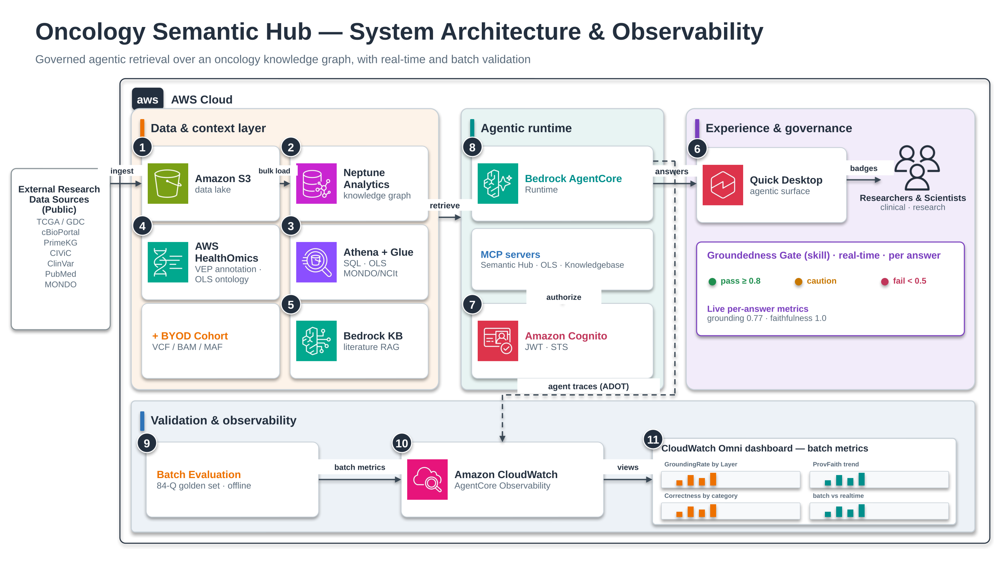
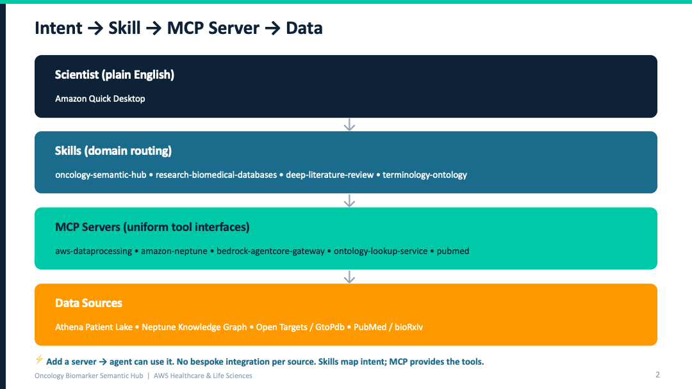

# Oncology Semantic Hub


An open solution accelerator that unifies cancer genomics (TCGA, cBioPortal), curated biomedical knowledge (PrimeKG), variant annotations (CIViC, ClinVar), and literature into a governed semantic layer for AI agents. An 84-question benchmark demonstrates that organising the same data as a semantic hub makes an agent 13% more correct and 10% more reproducible on hard oncology questions.



The agent reaches its tools through a layered path — plain-English intent, routed by a skill, served by MCP servers over governed data sources:



## Two Accelerators

### Accelerator 1: Oncology Starter Hub + BYOD
A working, deployable oncology research hub. Start with a validated foundation, add your own cohort + datasets.

| Component | Location | What it does |
|---|---|---|
| Agent (env-gated L0–L3) | `agentcore/semantic_hub_agent.py` | Single-file Strands agent deployed to AgentCore |
| Deploy script | `agentcore/deploy.py` | Package + deploy any tier to AgentCore Runtime |
| Data pipeline | `scripts/01_*` – `scripts/16_*` | Numbered ETL: PrimeKG → Neptune, GDC/cBio → Athena |
| RODA expansion | `scripts/roda/` | Add CIViC, ClinVar, and other open datasets |
| Knowledge Base | `agentcore/kb/` | Literature corpus builder (PubMed abstracts) |
| Demo app | `agentcore/chat_ui.py` | Streamlit compare-mode UI (L0/L2/L3 side-by-side) |
| BYOD guide | `docs/bring-your-own-data.md` | How to swap your cohort + KG |

**Quick start:** `agentcore/README.md`

### Accelerator 2: Semantic Hub Benchmark Framework
Measure whether YOUR semantic layer is worth the investment. Domain-agnostic methodology, oncology as the reference instance.

| Component | Location | What it does |
|---|---|---|
| Golden dataset | `ground_truth/golden_v2.json` | 84-question benchmark (12 categories) |
| Custom scorer | `agentcore/run_v2_benchmark.py` | F1 + reproducibility (5×) + self-agreement |
| Native eval | `agentcore/run_agentcore_eval.py` | AgentCore Builtin.Correctness + Faithfulness |
| Provenance scorer | `evaluation/provenance_faithfulness.py` | Layer-aware fabrication detection (novel) |
| Question generation | `evaluation/generate_questions.py` | Template-driven from live entity pools |
| Report | `docs/benchmark-report.md` | Full methodology + results + root-cause analysis |

**Quick start:** `evaluation/README.md`

## Results (84-Q, Claude Sonnet 4.5, temp=0)

| Metric | L0 (bare LLM) | L1 (lake) | L2 (flat data) | **L3 (semantic hub)** |
|---|---|---|---|---|
| Correctness | 0.131 | 0.405 | 0.667 | **0.798** |
| Reproducibly-correct (5×) | 0.165 | 0.417 | 0.632 | **0.733** |
| Grounding rate | 0.261 | 0.656 | 0.990 | **0.995** |

*Same data, same model — organizing it as a semantic hub makes the agent 13% more correct, 10% more reproducible, and nearly fully grounded.*

## Directory structure

```
oncology_semantic_hub/
├── agentcore/          ← Agent code + deploy + cleanup + eval runners (Accelerator 1 + 2)
├── hub_core/           ← Shared query core (Neptune/Athena executors + live schema)
├── evaluation/         ← Benchmark scorers + question generation (Accelerator 2)
├── ground_truth/       ← Golden datasets (golden_v2.json, 84-Q) + generators
├── tests/              ← unittest suites (benchmark framework, provenance)
├── scripts/            ← Data pipeline (Accelerator 1)
│   └── roda/           ← RODA dataset expansion
├── docs/               ← Documentation (both accelerators)
├── output/             ← Generated results (gitignored)
└── data/               ← Intermediate data (gitignored, reproduced via scripts/)
```

## Documentation

See `docs/README.md` for the full index. Key docs:
- **`docs/benchmark-report.md`** — the technical report
- **`docs/demo-golden-thread-v4.md`** — 4-question demo recording script
- **`docs/sales-enablement-brief.md`** — what's available + how customers get started
- **`docs/whitepaper-section-4.1-draft.md`** — detailed whitepaper section

## Prerequisites

- AWS account with Neptune Analytics, Athena, Bedrock, AgentCore
- Python 3.13+ with `strands-agents`, `bedrock-agentcore`, `mcp`
- AWS credentials with appropriate IAM permissions

```bash
python -m venv .venv && source .venv/bin/activate
pip install strands-agents[otel] bedrock-agentcore mcp boto3 streamlit
```

## Deploy

> **Before deploying:** complete the data pipeline (`scripts/`) and set the `SEMHUB_*` environment
> variables (account/region/graph id). See `scripts/README.md` and `agentcore/README.md` for the full
> env contract — `deploy.py` fails loudly if `SEMHUB_GRAPH_ID` is unset for graph layers.

```bash
# Deploy L3 (full semantic hub)
python agentcore/deploy.py --layer L3

# Deploy L2 (flat baseline, same data)
python agentcore/deploy.py --layer L2

# Run the benchmark
python agentcore/run_agentcore_eval.py
python agentcore/run_v2_benchmark.py
```

Each deploy writes a gitignored `agent_config[_<layer>].json` holding the runtime ARN + role (account-
specific — never committed).

## Test

Standard-library `unittest` (no `pytest`):

```bash
python -m unittest discover -s tests        # benchmark framework + provenance scorers
python -m unittest discover -s hub_core      # read-only query guards + live schema
python -m evaluation.test_scoring            # deterministic scorer assertions
```

## Teardown

The hub deploys billable resources — the Neptune Analytics graph and the Bedrock Knowledge Base bill
continuously. **Destroy them when done** (see [`docs/TEARDOWN.md`](docs/TEARDOWN.md) for the full runbook
and cost drivers):

```bash
python agentcore/cleanup.py --all            # delete every deployed layer's runtime + IAM role + code object
python agentcore/kb/create_kb.py --delete    # delete the Knowledge Base + vectors + SSM
# then: delete the Neptune graph, Glue DBs, and S3 buckets per docs/TEARDOWN.md
```

## Cost

See [`docs/COST_ANALYSIS.md`](docs/COST_ANALYSIS.md) for pilot / production / 10× estimates. In short:
Bedrock token cost dominates at production scale (~96%); Neptune Analytics (~$65/mo) and the KB are the
fixed, always-on costs that make teardown worthwhile between pilots.

## Known limitations

- **Demo-grade security posture — not configured for PHI.** The reference hub runs on public,
  de-identified TCGA data. Bringing your own patient cohort inherits HIPAA obligations and requires the
  hardening in `docs/bring-your-own-data.md` (per-user identity, VPC networking, KMS, least-privilege
  IAM) plus a signed AWS BAA. Do not run real patient data on the demo configuration.
- **Research use only — not for clinical decision-making.** Agent answers are for research and
  demonstration; they are not medical advice.
- **BYOD guidance, not an automated path.** The bring-your-own-data docs describe how to point the hub
  at your own resources; onboarding your data is a one-time ETL effort, not a drop-in.
- **~10 `scripts/` ETL steps pin `REGION = "us-west-2"`** as a module constant; redeploying the pipeline
  in another region currently needs those edited (tracked in the pre-PR review). The deployed agent is
  fully env-driven.
