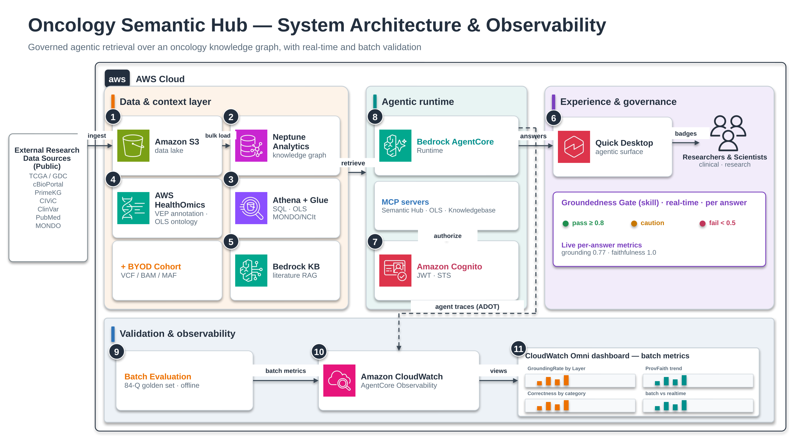

# Oncology Semantic Hub — Documentation

_Essential docs. Design history and visual assets in `archive/`._

## Operations

| Doc | Purpose |
|---|---|
| **TEARDOWN.md** | How to destroy every billable resource (runtimes, Neptune, Glue/Athena, S3, KB) — in order |
| **COST_ANALYSIS.md** | Pilot / production / 10× cost estimates, per-service drivers, scale trade-offs |
| **adr/** | Architecture Decision Records — why the system looks the way it does (5 ADRs + index) |

## Deliverables

| Doc | Purpose |
|---|---|
| **benchmark-report.md** | Technical report — methodology, metrics, results, root-cause analysis |
| **demo-golden-thread-v4.md** | Demo recording script — 4-question EGFR-GBM (L2 vs L3, L0 vs L3) |
| **quick-setup.md** | Connect the hub to Amazon Quick — 5 steps (token + 3 MCP servers + skill), demo questions, troubleshooting |
| **accelerator-positioning.md** | Positioning + path-to-field-ready + integration map (Stan/Chaitanya/Ariella-Michael/Indradeep). |
| **backlog.md** | Feature backlog (5 categories, 18 features). |
| **sales-enablement-brief.md** | Sales enablement — two accelerators, demo, how customers get started |
| **whitepaper-section-4.1-draft.md** | Whitepaper narrative — why / what / how + full results |
| **phase3-plan.md** | Phase 3 feature design tracks (radar chart · HealthOmics workflows · context graph) |

## Data & pipeline

| Doc | Purpose |
|---|---|
| **bring-your-own-data.md** | How customers swap their own cohort + KG |
| **data-pipeline-rebuild.md** | Runbook to reproduce the full pipeline from scratch |
| **data-provenance.md** | Data source citations, versions, licensing |

## RODA expansion

| Doc | Purpose |
|---|---|
| **roda_executive_summary.md** | Executive summary (Immediate / Short-term / Longer-term) |
| **roda_oncology_hub_complete_reference.md** | Complete reference — 28 datasets with pipelines |
| **roda_immediate_datasets_access_guide.md** | Access guide for coding agents |
| **roda-v3-spec.md** | Implementation spec (CIViC + ClinVar; built & validated) |

## Design

| Doc | Purpose |
|---|---|
| **remote-mcp-server-design.md** | Remote data MCP server on AgentCore Runtime (Neptune + Athena) — Quick-consumable over HTTPS+JWT, no local AWS creds; includes the shared `hub_core` query-core refactor. Backlog #22. |
| **per-user-auth-design.md** | Per-user auth / SSO model for the MCP servers (target state beyond the shared M2M client). Backlog #21. |

## Archive

`docs/archive/` — 19 files: architecture designs, requirement docs, working notes, visual assets,
product backlog. Retained for reference, not required for understanding or using the accelerators.
