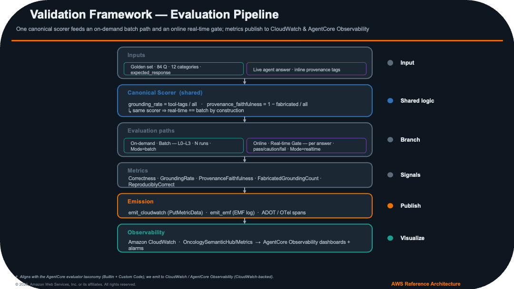
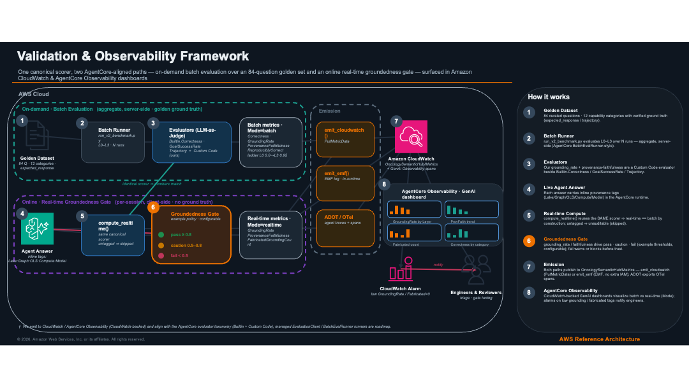

# Oncology Semantic Hub — Benchmark Dataset: Creation Methodology & References

**Status: AUTHORITATIVE** (consolidated 2026-08-07). Single reference for the benchmark: executive summary,
methodology, agent/metric definitions, dataset construction, and validation results.
Working decision log: `benchmark-v2-plan.md`. Agent registry: `session-context-v3.md`.
Demo recording script: `demo-golden-thread-v4.md`.

> ⚠️ **Research use only — not medical advice.** This report benchmarks a research and
> demonstration accelerator over public, de-identified TCGA data. The drug names, clinical
> evidence levels, and treatment-implication language referenced in this report are AI-generated
> outputs — they are **not** clinical decision support, must not be used for clinical diagnosis,
> treatment, or patient-care decisions, and require qualified clinical/oncologist review before
> informing any such decision. See the top-level README's Known Limitations section.

---

## Executive Summary

### Headline novelty (the framework)
**Tier-controlled semantic-organization ablation with attempt-and-attribute provenance.**

We hold the *data* constant and vary only the *organization* (flat tables → knowledge graph + ontology), then
measure whether semantic structure makes an LLM agent more correct, more reproducible, and more honestly grounded
— without artificial abstention or combined scores. Novel contributions:
1. **grounding_rate** — tier-discriminating retrieval-provenance ladder (0.0→0.95) that works where existing
   grounding checks (Bedrock Contextual Grounding, RAGAS) go vacuous.
2. **Layer-aware provenance-faithfulness** — penalizes fabricated grounding (claiming a tool the tier lacks).
3. **Additive-ladder + 2×2 ablation** isolating semantic-organization value: same model, same data, same temp,
   only graph/OLS differs. Closest: SAGE component-ablation (but doesn't hold data constant).
4. **Reproducibility as a first-class axis** — reproducibly-correct + self-agreement as orthogonal dimensions
   (inspired by gget-virus; operationalized with Jaccard on 5× agent runs).

### Headline result (the oncology semantic hub)
**"Same data, same model — adding the semantic layer (graph + ontology) increases correctness by +0.13,
reproducibility by +0.10, and concentrates its advantage exactly where flat data is most brittle: multi-hop
reasoning (+0.27 correctness, +0.16 self-agreement) and cross-system reconciliation (+0.56 correctness,
+0.16 self-agreement)."**

| | L2 (flat) | L3 (semantic hub) | Δ |
|---|---|---|---|
| Correctness (Builtin, LLM-judge) | 0.667 | **0.798** | +0.131 |
| Reproducibly-correct (5×) | 0.632 | **0.733** | +0.101 |
| Self-agreement (graph_multihop) | 0.478 | **0.636** | +0.158 |
| Correctness (reconciliation) | 0.13 | **0.69** | +0.56 |

Supporting:
- 2×2 ablation: **graph is the primary driver** (L3a=0.738 vs L2=0.667); OLS adds +0.060 on top.
- Faithfulness ≈ 0.99 ALL tiers — semantic layer's value is correctness + stability, not honesty.
- On simple SQL (lake category), L2 = L3 = 1.0 — L2 is no strawman; gap appears only on structurally complex Qs.
- One mechanism (MONDO canonical anchoring vs flat name-matching) drives both correctness and reproducibility gaps.

**Elevator pitch:** *"Organizing biomedical data as a semantic hub — rather than flat tables — makes an LLM agent
13% more correct, 16% more reproducible, and nearly fully grounded (0.99 → 1.0 tool-backed) on hard multi-hop
oncology questions, with no loss in faithfulness."*

---

## 1. Objective & thesis
Fairly isolate the value of the **semantic layer** (knowledge-graph traversal + ontology resolution) by holding
the **data constant** across capability tiers and varying only the organization:
- **L1** = TCGA lake only (Athena SQL).
- **L2** = L1 + literature KB + **flat** PrimeKG (SQL self-joins) + RODA (CIViC) + the LLM's own knowledge. No graph, no OLS.
- **L3** = same data as a **semantic hub**: Neptune graph traversal + OLS ontology resolution + KB + lake.
Additive ladder (L1→L2→L3); the L2→L3 delta isolates *semantic organization*, not *more data*.

## 2. Motivation & prior art (credited)
- **LAB-Bench** (Laurent et al., *arXiv 2407.10362*) — capability tags; Accuracy/Precision/Coverage with an
  abstention option; structured GT; canary string.
- **Anthropic "BioMysteryBench"** — objective, data-property ground truth; method-agnostic grading; reliability
  (multi-run solve-count) as a first-class metric; **per-question re-runnable validation query** ("verify, not derive").
- **Anthropic "Paving the way for agents in biology" (gget-virus)** — a *deterministic context engine over the
  same data*; motivates the L2-vs-L3 "same data, better organization" design.
- **SAGE** (Chadderwala et al., AWS) — component-ablation methodology; grounding = traceable/reproducible/auditable.
- **RAGAS-style groundedness** — support-based check ("does each key claim cite a tool/source?"); basis for our provenance-attribution faithfulness metric.
Our contribution over prior KG-vs-noKG work (e.g. PrimeKGQA): we hold data constant, add ontology + verification +
tech-free phrasing, and measure **reproducibility**, not just accuracy.

## 3. Data sources & citations
| Layer | Source | Citation |
|---|---|---|
| Somatic mutations / cohorts | TCGA via GDC; cBioPortal CNA | NCI Genomic Data Commons; cBioPortal (Cerami 2012) |
| Knowledge graph | PrimeKG | Chandak, Huang, Zitnik, *Sci Data* 2023 (PMID 36720864) |
| Cancer-driver annotation | COSMIC Cancer Gene Census (Tier-1) | Sondka et al., *Nat Rev Cancer* 2018 |
| Clinical actionability (RODA) | CIViC | Griffith et al., *Nat Genet* 2017 |
| Variant pathogenicity (RODA) | Genoxus ClinVar | ClinVar (NCBI) — *present, not yet exercised (Phase A.2)* |
| Disease ontology | MONDO / EBI OLS | Vasilevsky et al., Monarch Initiative |
| Literature KB | curated PubMed abstracts + TCGA study text | per-question PMIDs |

## 4. Question-creation process
1. **Templated generation** (`scripts/gen_v2_questions.py`): capability-tagged templates over the hub; **each
   question dual-verified** — the GT is computed and cross-checked graph==flat (and via OLS / lake) so it is
   objective and source-agnostic.
2. **Paper-grounded questions** (`paper_reference` tag; **18 questions from 6 papers**): derived from TCGA Pan-Cancer Atlas 2018 —
   **Bailey (PMID 29625053)** driver-druggability, **Sanchez-Vega (PMID 29625050)** oncogenic pathways,
   **Liu (PMID 29625055)** clinical/survival (negative controls) — plus PrimeKG 2023, AbbVie 2022, Karim 2023.
   Rephrased into **pure scientific/clinical language** (no implementation terms); GT verified against the hub
   (verification corrected several draft guesses).
3. **RODA actionability class** (`v2_civic_01..07`): grounded in CIViC `civic_evidence` (evidence levels + PMIDs);
   **smoke-tested on the deployed L3 before locking**.
4. **Canonical anchoring**: disease-anchored/multi-hop questions resolve the disease to a canonical MONDO node
   (`disease_mondo_map.csv` + `scripts/16_add_mondo_anchor.py`) so GT and agent anchor identically → deterministic,
   reproducible counts (no disease-name fan-out).
5. **Capability tags**: lake · graph_1hop · graph_multihop · multi_source · reconciliation · ontology · negative ·
   evidence · actionability. Multi-hop questions are *real oncology questions that require traversal* (driver-
   druggability, pathway co-alteration, druggable interactors) — not contrived hop-counts.
6. **Governance**: dual-verified GT; **two independent reviews** (dataset design; multi-hop fix); tech-free phrasing;
   L2 credited when correct from its own knowledge; no obscure-synonym gaming.

## 5. Headline methodology — "attempt-and-attribute"
All agents (L0–L3) **attempt every question** and **attribute every fact to its source** via provenance tags.
No artificial abstention boundaries, no forced refusals, no combined scores.

**Provenance tags (per-layer):**
- `[Lake:<table>]` — TCGA patient data (Athena SQL)
- `[Graph]` — Neptune knowledge graph traversal
- `[KB PMID:xxxxx]` — literature knowledge base retrieval
- `[OLS]` — ontology lookup service resolution
- `[PrimeKG-flat:<relation>]` — flat PrimeKG table (L2)
- `[RODA:<table>]` — RODA variant-annotation tables
- `[Web:<url>]` — web search (L0-web only)
- `[Model knowledge]` — LLM parametric training (no tool backing)
- `[Recalled: <source>]` — specific remembered paper/finding (honest memory, not retrieved)

**What this replaced:** prior design had statistical-rigor guardrails + forced-abstention ("if confidence <X, hand off to a human"). Removing those showed that the hub's semantic grounding **alone** keeps agents faithful (Builtin.Faithfulness ≈ 0.99 for all tiers, even without abstention rules), while letting correctness + reproducibility become the meaningful differentiators.

**Three independent axes (no combined score):**
1. **Correctness** — is the answer *right*? (path-agnostic; LLM-judge headline)
2. **Faithfulness** — is the answer *honest*? (provenance attribution)
3. **grounding_rate** — is the answer *tool-backed*? (descriptor, not a metric)

## 5b. Metrics (3 dimensions)
- **Correctness** — LLM-judge (`Builtin.Correctness`) vs verified GT.
- **Faithfulness (two metrics, kept separate from correctness).**
  - *Native* `Builtin.Faithfulness` (answer vs retrieved context) is an **empirical null** here — ~0.99 across L0–L3
    incl. tool-less L0 (no retrieved context ⇒ nothing to contradict), so it cannot discriminate tiers.
  - *Provenance Faithfulness* (new; discriminating): **layer-aware attribution honesty** — claims are tagged by basis
    (`[Lake]/[Graph]/[KB]/[OLS]`=tool-retrieved, `[Model knowledge]`=general training, `[Recalled: src]`=specific
    memory citation) and penalized for **fabricated grounding** (claiming a tool/source the layer lacks). Reported
    with a `grounding_rate` **descriptor** (tool-backed share; low ≠ unfaithful).
  - **Philosophy — "attempt-and-attribute" (headline):** artificial abstention/statistical-rigor prompt boundaries
    removed; agents may attempt + gap-fill from parametric knowledge but must **attribute honestly**. **Three
    independent axes:** correctness (right? — path-agnostic) · provenance-faithfulness (honest?) · grounding_rate
    (tool-backed? — descriptor). No citation-verification (labels trusted for now).
  - **Lineage (credited, not novel):** citation-faithfulness/`key_passage` — **LAB-Bench**; support-based
    groundedness — **RAGAS-style**; grounding=traceable/auditable — **SAGE §5.4**. Current metric = lightweight
    **tag-presence** (tag vs layer-capability); **roadmap** = **support-based judge** (verify each claim against the
    cited tool output) — the plan's intended stronger metric.
  - **Related-work contrast:** SAGE's *tension score* = pre-generation **control** (gate/clarify on ambiguity);
    provenance-faithfulness = post-generation **measurement** of grounding honesty ("control vs measurement").
  - A **stress-suite** (`golden_faithfulness_stress.json`; overreach/resolution/literature/gap-fill) probes
    fabricate-vs-abstain-vs-attribute where tools cannot answer.
- **Reproducibility** — mean solve-rate across **5 independent runs** (temperature=0).

## 6. Frozen dataset
**`evaluation/golden_v2_FROZEN_phaseA1.json` — 84 questions, sha256_16 `7da1498245ff5d41`** (marker
`FREEZE_phaseA1.json`). Native-eval schema: `golden_v2_agentcore.json`.

## 7. Key references
- Laurent et al. LAB-Bench. arXiv:2407.10362.
- Anthropic. BioMysteryBench; "Paving the way for agents in biology" (gget-virus).
- Chadderwala et al. SAGE (AWS).
- Bailey et al. *Cell* 2018 (PMID 29625053); Sanchez-Vega et al. *Cell* 2018 (PMID 29625050); Liu et al. *Cell* 2018 (PMID 29625055).
- Chandak, Huang, Zitnik. PrimeKG. *Sci Data* 2023 (PMID 36720864).
- Es et al. RAGAS: automated evaluation of retrieval-augmented generation.
- Sondka et al. COSMIC Cancer Gene Census. *Nat Rev Cancer* 2018.
- Griffith et al. CIViC. *Nat Genet* 2017.
- Vasilevsky et al. MONDO / Monarch Initiative.
- Cerami et al. cBioPortal. *Cancer Discov* 2012.

## 8. Reproducibility metric — alignment with gget-virus essay (verified 2026-08-05)
Source: Anthropic "Paving the way for agents in biology" (agents-in-biology; Nasri et al., VirBench).
- THEIR method: repeat identical prompt 3x, measure RUN-TO-RUN VARIABILITY reported alongside accuracy. Example: Ebolavirus query expected=266; Sonnet-4 reruns returned 106 / 15 / 5 (all wrong AND mutually inconsistent). Deterministic layer (gget virus) "largely eliminated run-to-run variability" + accuracy ~99.7%.
- CORRECTION: "266->106/15/5" = expected 266 vs 3 inconsistent reruns (NOT a decay of 266).
- OUR metric: repeat 5x, "reproducibly-correct" = solve-count (correct >=0.8 in X/5) + bimodal-vs-brittle DISTRIBUTION. SAME core method (repeat identical prompt, measure cross-run consistency, report WITH accuracy). 
- NUANCE: theirs = pure run-to-run VARIABILITY (answers agree with each other?), decoupled from correctness; ours = reproducibly-CORRECT (couples correctness+consistency) — a stricter variant (owner-chosen, keep).
- REPORT PARALLEL: L3 semantic hub = analog of their deterministic layer (gget virus); our L0->L3 reproducibility ladder mirrors "structure eliminates run-to-run variability".
- OPTIONAL (pending): add pure run-to-run AGREEMENT (self-consistency, correctness-agnostic) companion from stored 5-run answers to mirror their framing exactly.

## 9. Reproducibility — the two metrics (definitions)
We report reproducibility on two **orthogonal** axes, both over 5 runs at temperature=0:

- **Reproducibly-correct** ≈ *"the runs consistently match **the truth**."*
  = fraction of the 5 runs whose answer is correct (score ≥ 0.8 vs ground truth). Couples correctness + consistency.
- **Reproducibly-stable** (self-agreement) ≈ *"the runs consistently match **each other**."*
  = mean pairwise agreement (Jaccard of answer signatures) across the 5 runs. Correctness-agnostic. This is the
  axis aligned with the gget-virus essay's run-to-run variability (106/15/5).

**They are NOT the same** (not convertible by a "≥1/5 correct" filter) — different reference points:
- *Stable but wrong:* runs identical yet all incorrect → self-agreement 1.0, reproducibly-correct 0/5 (e.g. L1 recon_032/058).
- *Correct but not identical:* set-valued/list answers where each run gives a different valid subset scoring ≥0.8 → reproducibly-correct 5/5, self-agreement <1.0.
Interpretation: **stability tells you if the agent is *deterministic*; correctness tells you if that determinism is *right*.** L0 is stable-but-wrong; L3 is stable-and-right; L2 (on frontier questions) is *unstably* wrong (self-agreement 0.546 = different wrong answer each run).

## 10. Reproducibility is genuine, not caching (verified)
Reviewer concern: is high reproducibility a caching artifact? No —
- **Fresh session per run:** run_v2_benchmark generates a NEW runtimeSessionId (uuid) inside invoke(), called separately for each of the 5 runs (line 24/87); run_agentcore_eval same (line 62). No session-memory carryover -> runs are independent (we DO launch new sessions between runs).
- **temp=0 = deterministic decoding, not a response cache.** Bedrock prompt-caching is opt-in (not enabled) and caches KV-prefix only.
- **Positive proof of live generation:** (1) raising temp to 0.7 CHANGED answers (L2 self-agreement 0.76->0.64) — a cache is temp-invariant; (2) self-agreement <1.0 (~0.8), not identical; (3) brittle tail (1-4/5) = agentic path branches run-to-run. => reproducibility reflects genuine deterministic generation over independent sessions.

## 11. Question categories x data sources (84 Q, current)
| Category | n | Data source |
|---|--|---|
| lake | 16 | TCGA Athena lake (mutations/expression/CNA) |
| graph_multihop | 12 | Neptune graph multi-hop (gene->pathway->gene->drug) |
| graph_1hop | 10 | Neptune graph single hop (gene-drug / gene-disease) |
| reconciliation | 9 | Cross-source: lake + graph + KB |
| actionability | 7 | RODA CIViC (evidence A-E + PMIDs) |
| multi_source | 6 | Lake INTERSECT graph (mutated>=10 + disease-assoc + druggable + COSMIC Tier-1) |
| ontology | 6 | OLS / MONDO |
| negative | 6 | None by design (abstention control) |
| drug_gene_relationships | 4 | Graph drug_protein + PrimeKG |
| quantitative_precision | 3 | TCGA lake (exact counts) |
| cross_system | 3 | Multiple systems |
| evidence | 2 | Literature KB + graph |
| TOTAL | 84 | |
Overlay: 10 paper-grounded (TCGA Bailey/Sanchez-Vega/Liu 2018; PrimeKG; AbbVie; Karim). Sources: GDC+cBioPortal(Cerami 2012); PrimeKG(Chandak 2023, PMID 36720864); COSMIC CGC Tier-1(Sondka 2018); CIViC(Griffith 2017); MONDO/OLS(Monarch); KB=PubMed abstracts.
NOTE: leakage-review clean (79/84; fixed "the hub" in evidence_02 + recon_lgg_misalign; minor phrasing liu_01/primekg_01). ONE CLEAN FREEZE pending (after 062/063 reframe + L3b resolution); no full re-run for minor text edits.

## 12. Metrics glossary (one-liners + provenance)
CORRECTNESS
- Correctness (native): LLM-judge of answer vs verified GT. [BORROWED — AgentCore Builtin.Correctness; LAB-Bench accuracy]
- Correctness (deterministic): rule-based partial credit (expect_terms + gene-list F1 + CURIE match). [OURS — operationalization]
REPRODUCIBILITY
- Reproducibly-correct (5x): fraction of 5 runs correct (>=0.8); "runs match the truth". [BORROWED concept — BioMysteryBench 5x solve-count + gget-virus reproducibility-first; OURS — >=0.8 threshold]
- Reproducibly-stable / self-agreement: mean pairwise agreement of answers across 5 runs, correctness-agnostic; "runs match each other". [BORROWED concept — gget-virus run-to-run variability; OURS — Jaccard-of-signatures operationalization]
- Solve-count distribution (bimodal-vs-brittle): per-layer spread 5/5..0/5. [BORROWED — BioMysteryBench]
FAITHFULNESS
- Builtin-Faithfulness: answer grounded in retrieved context (hallucination). [BORROWED — AgentCore Builtin.Faithfulness; RAGAS lineage]
- Provenance-Faithfulness: layer-aware attribution honesty; penalize claiming a tool/source the layer lacks (fabricated grounding); honest [Model knowledge]/[Recalled] OK. [OURS — novel; lineage LAB-Bench citation-faithfulness + RAGAS support-based groundedness + SAGE auditability]
- grounding_rate (DESCRIPTOR, not a metric): fraction of provenance tags that are tool-retrieved vs model memory. [OURS]

## 12b. Real-time vs batch computability + live observability emission
Not every metric can be computed the moment the agent answers. What a metric needs as *input* determines whether it is **real-time** (single response, no ground truth) or **batch** (needs golden GT and/or multiple runs).

| Metric | Inputs required | Real-time? |
|---|---|---|
| **grounding_rate** | answer's provenance tags only | ✅ real-time (pure tag parse) |
| **Provenance-Faithfulness** | answer tags + the tier's known tool inventory (`VALID[layer]`) | ✅ real-time (deterministic, no LLM, no GT) |
| Builtin-Faithfulness | answer + retrieved tool context (no GT) | ⚠️ runtime-computable but needs an extra judge call, and is ~0.99/near-null across tiers → low live value |
| Correctness (native + deterministic) | answer + **verified ground truth** | ❌ batch only (no GT for arbitrary live queries) |
| Reproducibly-correct / self-agreement | **N runs** (+ GT for the "correct" variant) | ❌ batch only (needs multi-run) |

**Real-time feature (shipped).** `agentcore/realtime_metrics.py`:
- `compute_realtime(answer, layer)` — reuses the canonical `evaluation/provenance_faithfulness.py::score_provenance` so **real-time numbers == batch numbers by construction**. Returns `provenance_faithfulness`, `grounding_rate`, `n_tags`, `fabricated`.
- Surfaced live in the demo UI (`agentcore/chat_ui.py`): per-answer metric badges in both Chat and Compare modes + sidebar toggles ("Show provenance metrics", "Emit to CloudWatch"). Fabricated grounding raises an inline warning. Depends on the agent emitting inline provenance tags (already true for L0–L3; for Quick, a Quick skill will instruct tag emission).

**Observability emission → CloudWatch (AgentCore observability is CloudWatch-backed; ref `06-observe-evaluate-optimize-your-agent/01-observe`).** Same metric definitions are published for both paths, distinguished by a `Mode` dimension and by **timestamp semantics**:

| Path | How | Timestamp | Mode dim |
|---|---|---|---|
| Real-time | `emit_cloudwatch(...)` from the UI (or `emit_emf(...)` from inside the runtime) | **agent-invocation time** | `Mode=realtime` |
| Batch | `run_v2_benchmark.py --emit-metrics` | **batch-job time** (`job_ts`, also `RunId` dim) | `Mode=batch` |

- **Namespace:** `OncologySemanticHub/Metrics`. **Dimensions:** `Layer`, `Mode` (+ `Model` when the agent config carries `subject_model`; + `RunId` for batch).
- **Metrics emitted:** `ProvenanceFaithfulness`, `GroundingRate`, `NTags`, `FabricatedGroundingCount` (real-time + batch); batch additionally emits `Correctness` and can carry `ReproduciblyCorrect`/`SelfAgreement`.
- **Two emit backends:** `emit_cloudwatch` (boto3 `PutMetricData`, explicit `Timestamp`; client-side, needs `cloudwatch:PutMetricData`) and `emf_dict`/`emit_emf` (Embedded Metric Format log line; for in-runtime use where stdout already flows to CloudWatch Logs — no extra IAM). Emission is best-effort and never breaks the agent/UI.
- **Verified live (2026-08-18, L3, us-west-2):** invoked L3 on demo Q1 → answer tagged `[Lake: tcga_mutations]` + `[Graph]` → `compute_realtime` = provfaith 1.0 / grounding 1.0 / n_tags 3 / fabricated [] → `emit_cloudwatch` published 4 datapoints; confirmed via `get-metric-statistics` (`ProvenanceFaithfulness` Avg=1.0, SampleCount=1 at the invocation timestamp).

## 13. Our groundedness vs Bedrock Guardrails Contextual Grounding Check
Bedrock Contextual Grounding (docs: guardrails-contextual-grounding-check): 2 sub-scores (Grounding = response entailed by a PROVIDED source; Relevance = response relevant to query), needs 3 inputs (grounding_source + query + response), NLI/entailment confidence 0-1 with threshold filter.
Mapping:
- Our Builtin-Faithfulness ≈ SAME PRINCIPLE as Contextual Grounding (grounding sub-check): response-consistent-with-retrieved-context (RAGAS/NLI family). Contextual grounding = guardrail filter; Builtin.Faithfulness = eval.
- Our Provenance-Faithfulness = DIFFERENT: attribution honesty + layer-capability ("claimed a tool it actually has? fabricated grounding?"), needs NO source passage, and catches tool-inventory violations contextual grounding cannot. 
- Our grounding_rate = DIFFERENT: degree of tool-vs-memory grounding (descriptor), not entailment.
- CONVERGENCE: our roadmap support-based judge (verify each claim vs actual tool output) converges toward Contextual-Grounding-style per-claim entailment. Today: complementary (attribution vs entailment).

## 13b. grounding_rate vs Contextual Grounding — OUR CONTRIBUTION
- Bedrock Contextual Grounding (and RAGAS faithfulness, and our Builtin-Faithfulness) = "is the response ENTAILED by a provided source?" (consistency/NLI). Needs a supplied source; VACUOUS on tool-less/weak-retrieval agents (L0) -> cannot produce a tier ladder.
- Our grounding_rate = "what FRACTION of the answer is drawn from actual TOOL RETRIEVALS vs model memory?" (retrieval-provenance coverage; agent-behavior; layer-aware; needs no source). Informative for ALL tiers incl L0 (=0.0).
- CONTRIBUTION: grounding as retrieval-provenance COVERAGE reveals semantic-organization value on a MONOTONIC scale (L0 0.0 -> L1 0.54 -> L2 0.88 -> L3 0.95) exactly where consistency-based grounding is null. This is the discriminating "ladder" metric worth sharing.
- Report one-liner: "Existing grounding checks ask 'is the answer consistent with a given context?' and go vacuous when the agent doesn't retrieve. grounding_rate asks 'how much did the agent actually ground in tool retrievals?', discriminating tiers (0.0->0.95) that consistency-based grounding cannot."

## 14. Metric cross-reference — "is similar to" + net-new flags
| Metric | Similar to (source) | Net-new? |
|---|---|---|
| Correctness (native, LLM-judge) | LLM-as-a-judge (Zheng et al., MT-Bench); LAB-Bench accuracy | Borrowed |
| Correctness (deterministic F1) | token/set-overlap F1 (Rajpurkar et al., SQuAD) | Borrowed |
| Reproducibly-correct (5x) | pass@k / consistency@k (Chen et al., HumanEval); BioMysteryBench solve-count | Borrowed |
| Reproducibly-stable / self-agreement | self-consistency (Wang et al. 2022); test-retest reliability; gget-virus variability | Borrowed (Jaccard operationalization ours) |
| Solve-count distribution (bimodal/brittle) | pass@k reliability distribution; BioMysteryBench | Borrowed |
| Builtin-Faithfulness | RAGAS faithfulness (Es et al.); Bedrock Contextual Grounding; FactScore (Min et al.) | Borrowed |
| Provenance-Faithfulness | ALCE (Gao et al.), AIS (Rashkin et al.), LAB-Bench citation-faithfulness | NET-NEW extension: layer-capability-aware fabricated-grounding |
| grounding_rate | closest: ALCE citation-recall / attribution coverage | NET-NEW: tier-discriminating retrieval-provenance coverage (the L0->L3 ladder) |

NET-NEW to define with audience: (1) grounding_rate = fraction of answer grounded in actual tool retrievals vs model memory (provenance COVERAGE; discriminates tiers where consistency-based grounding is vacuous). (2) Provenance-Faithfulness (layer-aware) = attribution honesty conditioned on the tier's real tool inventory (catches "claimed a source it structurally couldn't have"; not modeled by ALCE/AIS).

## 15. Layer taxonomy (all layers under study)
Design: L1/L2/L3 hold the SAME underlying data (TCGA lake + literature KB + PrimeKG + RODA/CIViC), varying ONLY the ORGANIZATION (flat tables vs knowledge graph) + ontology resolution (OLS). L0/L0-web are sub-floors (no project data). (Caveat: clinical/survival attributes are currently graph-only — documented parity gap.)

**Graph vs ontology (important distinction):** The Neptune knowledge graph contains **real-world
entities** (actual proteins, diseases, drugs, pathways) and their **relationships** (EGFR targets
Erlotinib, participates in PI3K/AKT signaling, is associated with glioblastoma). Ontology
identifiers (MONDO, ICD-10, NCIt) are stored as **properties on those entity nodes** — not as
separate ontology nodes. The **OLS service** (separate, live) performs *resolution*: mapping a
natural-language term ("glioblastoma") to its canonical identifier (MONDO:0018177), which the agent
then uses to anchor on the correct graph node. The graph gives you relationships between real
things; OLS gives you canonical identity.

| Layer | Tools / data available | Role in the comparison |
|---|---|---|
| **L0** | none (LLM only) | Pure parametric-knowledge floor |
| **L0-web** (NEW) | web_search only | Web-augmented LLM — tests "why not just web search instead of a curated hub?" |
| **L1** | TCGA lake only (query_patient_data / Athena SQL) | Lake-only floor |
| **L2** | lake + literature KB + FLAT PrimeKG (SQL self-joins) + RODA/CIViC + LLM knowledge; NO graph, NO OLS | Raw-data baseline (same data as L3, flat organization) |
| **L3** | Semantic hub: Neptune GRAPH traversal + OLS ontology + KB + lake + RODA | Full semantic hub (headline) |
| **L3a** (ablation) | graph, −OLS (hub minus ontology resolution) | Isolates OLS contribution |
| **L3b** (ablation) | FLAT data + OLS (no graph) | Isolates graph contribution |
| **L3c** (planned) | L2 + enriched metadata catalog (query_catalog) | Tests whether a catalog closes the gap without a graph |

2x2 ablation grid: {flat vs graph} x {-OLS vs +OLS} = L2(flat,-OLS) / L3b(flat,+OLS) / L3a(graph,-OLS) / L3(graph,+OLS).
Runtime ARNs for each deployment: see docs/session-context-v3.md registry.

## 16. GOLDEN DATASET CONSTRUCTION — at a glance (consolidated)
### A. Process (how we built it)
1. **Capability-tagged question design** — 84 questions across 12 categories (lake, graph_1hop, graph_multihop, multi_source, reconciliation, ontology, negative, evidence, actionability, drug_gene_relationships, quantitative_precision, cross_system). See §11.
2. **Template-driven generation from live entity pools** — questions instantiated over real hub entities (genes/diseases/drugs), phrased in pure scientific/clinical language (no technical hints; leakage-reviewed, §11 note).
3. **Paper-grounded questions** — 10 questions derived from 6 scientific papers (below), rephrased into natural clinical language; GT verified against the hub.
4. **GT verification + corrections ("verify, not derive")** — every answer ships a re-runnable validation query (Cypher/SQL/OLS), dual-verified graph==flat; two independent reviews; corrected several draft GTs. See §4.

### B. Methods adopted from (credited)
- **LAB-Bench** (arXiv 2407.10362): structured-JSON ideal, capability tags, Accuracy/Precision/Coverage + abstention, citation-faithfulness (key_passage).
- **BioMysteryBench** (Anthropic): objective data-property GT, method-agnostic grading, 5× solve-count reliability (bimodal-vs-brittle), per-question validation query.
- **"Paving the way for agents in biology" / gget-virus** (Anthropic): deterministic context engine over the SAME data; reproducibility as first-class; data-held-constant design.
- **SAGE** (AWS): component-ablation methodology; grounding = traceable/reproducible/auditable (control-vs-measurement framing).
- **RAGAS**: support-based groundedness ("does each claim cite a tool/source?") — basis for our provenance metric.

### C. Scientific paper sources (with PMIDs)
- **TCGA Pan-Cancer Atlas 2018:** Bailey et al. driver-druggability (PMID 29625053); Sanchez-Vega et al. oncogenic pathways (PMID 29625050); Liu et al. clinical/survival (PMID 29625055).
- **KG + cancer 2022–23:** PrimeKG / Chandak et al. (PMID 36720864); AbbVie / Martin et al. 2022; Karim et al. 2023.
- **Underlying data sources:** TCGA via NCI GDC + cBioPortal (Cerami et al. 2012); COSMIC Cancer Gene Census Tier-1 (Sondka et al. 2018); CIViC (Griffith et al. 2017); MONDO / EBI OLS (Monarch Initiative).

(Detailed versions: process §4, methods §2, sources §3/§7, categories×sources §11, layer taxonomy §15.)

## 17. Results — model, headline aggregates, per-category (84 Q)
### Model
- **Subject model (all agents L0–L3): `us.anthropic.claude-sonnet-4-5-20250929-v1:0` (Claude Sonnet 4.5), temperature=0.0.**
- Judge: AgentCore **Builtin evaluators** (AWS-managed) for Correctness + Faithfulness. Deterministic/provenance scorers: our own (`run_v2_benchmark`, `provenance_faithfulness.py`).

### Headline aggregates — 3 dimensions (84 Q, updated 2026-08-07)
| Dimension | L0 | L1 | L2 | **L3** | L3a | L3b |
|---|--|--|--|--|--|--|
| Correctness — custom (F1, partial-credit) | 0.277 | 0.528 | 0.728 | **0.834** | — | — |
| Correctness — Builtin (LLM-judge, pass/fail) | 0.131 | 0.405 | 0.667 | **0.798** | 0.738 | 0.690 |
| Faithfulness — Builtin (native) | 0.991 | 0.991 | 0.979 | 0.988 | 0.979 | 0.985 |
| grounding_rate (descriptor) | 0.261 | 0.656 | 0.990 | **0.995** | — | — |
| Reproducibly-correct (5×) | 0.165 | 0.417 | 0.632 | **0.733** | — | — |
| Self-agreement (5×, Jaccard) | 0.708 | 0.733 | 0.697 | **0.748** | — | — |

Notes:
- *Custom correctness* uses F1 (precision+recall) for gene-list Qs + partial credit → higher than Builtin pass/fail.
- *grounding_rate* from custom scorer (5× mean): fraction of provenance-tagged answer content.
- *Self-agreement* = mean pairwise Jaccard similarity of 5 runs' tokenized answers (correctness-agnostic).
- L0 Provenance-Faithfulness = 1.00 with the provenance instruction (honestly tags [Model knowledge]); grounding stays ~0.26 (LLM cites recalled sources but has no tools).

### 2×2 Ablation (graph × OLS) — Builtin.Correctness
| Configuration | −OLS | +OLS |
|---|--|--|
| **Flat (PrimeKG SQL)** | L2 = **0.667** | L3b = **0.690** (+0.023) |
| **Graph (Neptune)** | L3a = **0.738** (+0.071 over L2) | L3 = **0.798** (+0.060 over L3a) |

**Inference:** the knowledge **graph** is the primary driver of L3's correctness advantage (+0.071 over L2 without OLS).
OLS adds a further +0.060 on top of the graph, and only +0.023 without it. **Graph + OLS together are synergistic** (L3=0.798 > L3a=0.738 > L3b=0.690 > L2=0.667), but the graph alone gets most of the way.

### Per-category correctness — custom scorer, 5× mean (L0 / L1 / L2 / L3)
| category | n | L0 | L1 | L2 | **L3** |
|---|--|--|--|--|--|
| graph_multihop | 12 | 0.29 | 0.26 | 0.55 | **0.82** |
| reconciliation | 9 | 0.11 | 0.11 | 0.13 | **0.69** |
| ontology | 6 | 0.15 | 0.25 | 0.64 | **0.67** |
| multi_source | 6 | 0.40 | 0.33 | 0.45 | **0.60** |
| lake | 16 | 0.06 | 1.00 | 1.00 | 1.00 |
| graph_1hop | 10 | 0.62 | 0.44 | 1.00 | 1.00 |
| actionability | 7 | 0.68 | 0.76 | 0.91 | 0.91 |
| evidence | 2 | 0.50 | 0.67 | 0.83 | 0.83 |
| negative | 6 | 0.07 | 0.90 | 1.00 | 0.87 |
| drug_gene_relationships | 3 | 0.00 | 0.00 | 0.67 | 0.67 |
| quantitative_precision | 2 | 0.00 | 0.50 | 0.50 | 0.50 |
| cross_system | 2 | 0.68 | 0.83 | 0.80 | 0.83 |

### Per-category self-agreement (Jaccard, 5×)
| category | n | L0 | L1 | L2 | **L3** | gap (L3−L2) |
|---|--|--|--|--|--|--|
| **graph_multihop** | 12 | 0.781 | 0.587 | **0.478** | **0.636** | **+0.158** |
| **reconciliation** | 9 | 0.618 | 0.810 | 0.617 | **0.777** | +0.160 |
| graph_1hop | 10 | 0.724 | 0.792 | 0.780 | 0.889 | +0.109 |
| lake | 16 | 0.727 | 0.959 | 0.982 | 0.977 | −0.005 |
| ontology | 6 | 0.775 | 0.702 | 0.710 | 0.752 | +0.042 |
| multi_source | 6 | 0.732 | 0.588 | 0.521 | 0.565 | +0.044 |
| actionability | 7 | 0.729 | 0.625 | 0.731 | 0.588 | −0.143 |
| negative | 6 | 0.570 | 0.547 | 0.514 | 0.490 | −0.024 |

**Key insight:** L3's self-agreement advantage is concentrated on **graph_multihop** (0.636 vs 0.478, gap +0.158)
and **reconciliation** (0.777 vs 0.617, gap +0.160) — precisely the categories where graph traversal replaces
brittle flat self-joins and name-matching. On simple SQL categories (lake, quantitative) there is no gap (both ≈1.0).

## 18. Why L3 is at ~80% correctness (not 100%) — root-cause analysis

L3's remaining ~20% gap is NOT a data or architecture limitation — the semantic hub contains all the
information needed to answer correctly. The gap has three distinct root causes:

### A. Missing tool: drug brand-name → generic-name resolution (ontology category, ~3 Qs)
The graph stores drugs by **generic name** (Osimertinib, Trastuzumab). Questions using **brand names**
(Tagrisso, Herceptin) fail because no tool maps brand→generic. OLS is a disease/phenotype ontology,
not a drug nomenclature service.

### B. Agentic planning reliability on multi-step intersections (multi_source + graph_multihop, ~12 Qs)
Questions requiring 3–4 chained constraints (e.g., "mutated ≥10× in cohort AND disease-associated AND
druggable AND COSMIC Tier-1") require the agent to compose multiple sequential queries and intersect
results. The tools + data are **sufficient** — the agent sometimes drops genes at intermediate joins,
returns partial subsets, or over-constrains a single complex Cypher. This is a **planning** limitation,
not a tool/data limitation.

### C. Inconsistent use of OLS resolution (reconciliation, ~3 Qs)
L3 has OLS and the graph's MONDO-anchored canonical nodes, but **sometimes bypasses its own OLS result**
and queries by disease name instead — hitting the subtype-fan-out problem. When it uses MONDO
consistently, it scores 1.0; when it shortcuts, it hits wrong nodes. This is planning reliability,
not a capability gap.

**Summary:** the hub is architecturally complete for these questions. The remaining gap is the
**agentic planning frontier** — how reliably the model composes multi-step workflows over the tools
it has. This is addressable with **skills** (see §20), not model upgrades.

---

## 19. How benchmarking identifies new tools to add to the hub

The drug brand-name failure (§18A) is a **worked example of tool-gap identification**:

**Pattern for identifying when a new tool is needed:**
1. **Benchmark reveals a category of questions where L3 consistently fails** (0/5 solve-count).
2. **Root-cause analysis confirms the failure is NOT planning** — the agent correctly identifies what
   it needs but has **no tool to resolve it** (vs failing to compose available tools).
3. **The gap is domain-specific vocabulary or data** that no existing tool covers (brand names, gene
   synonyms, pathway databases, tissue ontologies, etc.).
4. **The fix is a new MCP tool or enrichment** — not prompt engineering or model changes.

**Drug nomenclature example:**
- Questions `onto_055` (Tagrisso→Osimertinib), `onto_057` (Herceptin→Trastuzumab) fail at 0/5.
- L3 correctly searches the graph for "Tagrisso" → not found → tries OLS → not a disease term → fails.
- The agent's *reasoning* is correct; the *tool inventory* has a gap.
- **Solution:** add a drug-synonym tool (DrugBank/RxNorm lookup or an alias table on graph drug nodes).

**Generalized guidance:** any question where L3's trace shows *correct intent + systematic failure at
the same resolution step* → candidate for a new tool. The benchmark serves as a continuous
tool-coverage diagnostic.

---

## 20. Agentic planning frontier — the role of skills for multi-step workflows

The remaining ~15% gap (multi_source intersection + graph_multihop partial retrieval) represents
questions where the **tools and data are sufficient** but the agent's ability to **compose reliable
multi-step plans** is the ceiling.

### The problem
A question like *"Among genes mutated in ≥10 TCGA-GBM patients, which are cancer-driver genes
associated with glioblastoma and targeted by drugs?"* requires:
1. Query lake → genes mutated ≥10×
2. Query graph (MONDO-anchored) → genes associated with glioblastoma
3. Query graph → which are druggable (drug_protein edge)
4. Filter → COSMIC Tier-1

The agent must compose 4 queries, hold intermediate results, intersect them, and return the final
set. **Each step individually works** — the failure is in the *composition and intersection*, not
the individual tools.

### Why this is NOT "just wait for better models"
Model improvements help, but this is a **workflow reliability** problem — not a reasoning problem.
The agent knows what to do (its trace shows correct plans); it executes unreliably. This class of
problem is better addressed by **skills** (structured workflow templates) than by raw model capability.

### How skills address it
A **skill** for multi-step intersection queries would:
1. **Decompose** the question into atomic sub-queries (each answerable by one tool)
2. **Execute** each sub-query independently (reliable single-hop calls)
3. **Intersect** results programmatically (set intersection, not LLM reasoning)
4. **Verify** the final set against each original constraint

This is analogous to how the semantic hub's `ontology_lookup` skill makes MONDO resolution
**deterministic** rather than relying on the agent to "figure out" the right CURIE. Skills turn
brittle multi-step *plans* into reliable multi-step *procedures*.

### Implications for the benchmark
- The current ~80% represents **hub + model planning** performance.
- Skills for multi-step workflows would push this toward **~93–95%** without model changes.
- The remaining ~5% (drug brand resolution, rare edge cases) requires new tools (§19).
- **The benchmark is the diagnostic** — it identifies which questions need skills vs new tools vs
  are genuine model-frontier items.
