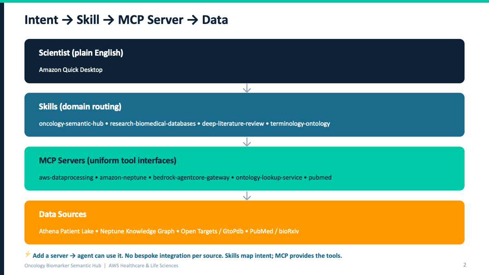

# Design — Remote Data MCP Server on AgentCore Runtime (Neptune + Athena)

> **Status:** PLAN (awaiting go-ahead to build). Backlog **#22**; enables the **Quick Desktop demo**
> and satisfies the tag-emission dependency of **#23** (real-time metrics). Relates to **#21**
> (per-user governance) and **#20** (semantic-hub architecture).
> **Modeled on:** `02-host-your-agent/01-runtime/02-hosting-tools/01-mcp-server-basics/` (FastMCP +
> `serverProtocol=MCP`, no Docker) and this repo's `mcp-servers/agentcore-runtime/ontology-lookup-service/`
> (Cognito JWT auth, SSM params, Quick wiring).

---

## 1. Goal

Expose the hub's custom **Neptune** and **Athena** query tools as **one deployed remote MCP server** on
Amazon Bedrock AgentCore Runtime, so any MCP-compatible client — **Amazon Quick Desktop** first — can
call them over HTTPS **without local AWS credentials**, matching the frontend-agnostic backend story.

**Non-goals:** re-implement the OLS server (already deployed separately); change the benchmark agent's
in-process tools (they stay for ablation control); write/mutation tools of any kind.

> **Status update:** this design has since been **built and deployed** — see
> `mcp-servers/agentcore-runtime/oncology-hub-data/` (live `runtime_config.json`, real `agent_arn` in
> the deploy account). The `Status: PLAN` marker above is stale; the rest of this doc is kept as the
> design record (why it's shaped this way), per ADR 0004.

The shipped layering (benchmark agent's own tools stay in-process via `hub_core/`; the remote MCP
server is a second consumer of the same `hub_core/`, serving non-AWS-SDK clients — Quick, Claude Code,
Kiro — over HTTPS+JWT):




## 2. Why remote (vs local stdio MCP)

See the parent discussion. Summary: local stdio (public AWS Labs servers or a boto3 wrapper) needs
local AWS creds + env on every consumer and gives a single identity with no central audit; a remote
Runtime server is hosted once, consumable by non-AWS Quick users over HTTPS+JWT, centrally governed
(Cognito + per-request `sts:AssumeRole` — the #21 rationale), and preserves our curated read-only
oncology tool surface. We keep a **local stdio mode of the same module** for fast dev (the peer's
Option 1) — one codebase, two run modes.

## 3. Tools exposed (single server: `oncology-hub-data`)

| MCP tool | Wraps (today in `agentcore/semantic_hub_agent.py`) | Backend |
|---|---|---|
| `query_knowledge_graph(cypher_query)` | `query_knowledge_graph` | Neptune Analytics (openCypher, read) |
| `query_patient_data(sql_query)` | `query_patient_data` | Athena (`oncology_semantic_hub`) |
| `query_variant_annotation(sql_query)` | `query_variant_annotation` | Athena RODA (`genoxus_clinvar`, `civic_evidence`, + any onboarded `*_staging`) |
| `get_hub_schema()` | **rewritten** — live Glue `GetDatabases/GetTables` + Neptune `get_graph_schema` (see §5) | Glue catalog + Neptune |

> **Note (alignment with `dataset_onboarding/`):** the RODA tool is a *generic* Athena SQL executor
> scoped to the RODA database — **not** one tool per dataset — so tables added by the onboarding
> pipeline (registered in Glue) are queryable with **no server change** (P1 proved this "no-redeploy"
> behavior on `tcga_staging`). The only piece that was dataset-coupled is the **hardcoded**
> `get_hub_schema` string; §5 replaces it with live introspection so onboarded datasets self-surface.

`ontology_lookup` (OLS) and `knowledge_search` (Bedrock KB) remain their own servers/resources — the
Quick skill composes across all of them. `query_primekg` (L2 flat) is benchmark-only, not hosted.

## 4. Architecture

```
Amazon Quick Desktop (Settings > Capabilities > Add MCP server: HTTP URL + Bearer token)
        │  HTTPS + JWT
        ▼
AgentCore Runtime  (serverProtocol=MCP, streamable-http, 0.0.0.0:8000/mcp)
        │  FastMCP server: oncology-hub-data
        ▼  boto3 (execution role, or assume-role-per-request for tenancy)
   Neptune Analytics  ·  Athena + Glue + S3 (query results)
```

## 5. Refactor first — one shared query core (avoid drift)

Extract the query bodies out of the Strands `@tool` functions in `agentcore/semantic_hub_agent.py`
into a pure module, e.g. `oncology_semantic_hub/hub_core/queries.py`:

```python
def run_opencypher(cypher_query: str) -> str: ...
def run_athena_sql(sql_query: str, database: str) -> str: ...
def run_variant_sql(sql_query: str) -> str: ...
def get_hub_schema() -> str: ...   # LIVE: Glue GetDatabases/GetTables + Neptune get_graph_schema
```

Both consumers import this core:
- the existing Strands agent (`@tool` wrappers become thin shims — no behavior change), and
- the new MCP server (`@mcp.tool()` wrappers).

This keeps the benchmark agent and the hosted MCP server on **one implementation** of the query logic.

**Important correction — `get_hub_schema` becomes live introspection.** Today `get_hub_schema` returns a
**hardcoded string** (node/edge/table descriptions). That is dataset-coupled: a newly onboarded table
won't appear until the string is edited — the exact anti-pattern `dataset_onboarding/` removes. The core
version should introspect **live**: Glue `GetDatabases`/`GetTables` over the Athena DBs (`oncology_semantic_hub`,
`oncology_semantic_hub_roda`, incl. onboarded `*_staging`) + Neptune `get_graph_schema`, with the curated
hints (MONDO-anchoring, partition columns) layered on as a small static preamble. Result: datasets added by
the onboarding pipeline **self-surface** to the agent and the MCP server with no code change — closing the
loop with P1's "no-redeploy" data plane. (Keep the old string only as the fallback preamble.)

## 6. The MCP server (`mcp-servers/agentcore-runtime/oncology-hub-data/mcp_server.py`)

Pattern from the reference example:

```python
from mcp.server.fastmcp import FastMCP
from hub_core.queries import run_opencypher, run_athena_sql, run_variant_sql, get_hub_schema

mcp = FastMCP("oncology-hub-data", host="0.0.0.0", stateless_http=True, json_response=True)  # AgentCore-compatible

@mcp.tool()
def query_knowledge_graph(cypher_query: str) -> str:
    """Run a READ-ONLY openCypher query against the Oncology Semantic Hub Neptune graph
    (PrimeKG + TCGA case/sample nodes + ClinVar/COSMIC/MONDO enrichments)."""
    _reject_mutations(cypher_query)          # guard: no CREATE/MERGE/DELETE/SET
    return run_opencypher(cypher_query)

@mcp.tool()
def query_patient_data(sql_query: str) -> str:
    """Run READ-ONLY SQL against the TCGA patient data lake via Athena."""
    _require_select(sql_query)               # guard: SELECT/SHOW/DESCRIBE only
    return run_athena_sql(sql_query, database=ATHENA_DB)

# query_variant_annotation, get_hub_schema likewise

if __name__ == "__main__":
    mcp.run(transport="streamable-http")     # also serves local stdio dev mode
```

**Read-only guards** (`_reject_mutations`, `_require_select`) are enforced in-process — defense in depth
on top of least-privilege IAM (no write actions granted).

## 7. Deployment (`deploy.py`, no Docker)

Model on `01-mcp-server-basics/deploy.py`:
1. Create execution role — **beyond CloudWatch logs**, add: `athena:StartQueryExecution/GetQueryExecution/GetQueryResults`, `glue:GetDatabases/GetTables/GetTable/GetDatabase/GetPartitions` (needed for live `get_hub_schema` introspection), `s3:GetObject` on the data bucket + `s3:PutObject/GetObject` on the `athena-results/` prefix, and `neptune-graph:ReadDataViaQuery` on the graph ARN.
2. `uv pip install` arm64 deps → zip (`mcp_server.py` + `hub_core/` + `requirements.txt`) → S3.
3. `bedrock-agentcore-control.create_agent_runtime(..., protocolConfiguration={"serverProtocol":"MCP"}, networkConfiguration={"networkMode":"PUBLIC"})` → wait `READY` → `create_agent_runtime_endpoint`.
4. Write `mcp_url` / `agent_arn` / `agent_id` to **SSM** (mirror the OLS param layout under `/app/oncology-hub-data/agentcore/...`).

## 8. Auth — DECIDED: Cognito M2M, consistent with OLS

Match the OLS Runtime server exactly: **Cognito M2M OAuth2 `client_credentials`** flow + **CUSTOM_JWT**
authorizer. Consumers exchange client_id/secret → short-lived Bearer JWT (access token TTL 60 min) and
add `Authorization: Bearer <token>`. Quick: **Settings > Capabilities > Add MCP server (HTTP)** + header.

**Explicit dependency (must be called out in the server README):** the OLS Runtime server and its Cognito
stack are a **separate component, deployed independently** (not owned by this repo). This data MCP server
does **not** stand up its own auth — it **reuses the Cognito user pool / M2M client already deployed by OLS**,
reading its SSM parameters (`/app/ontology-lookup-service/agentcore/{machine_client_id, cognito_secret,
cognito_token_url, cognito_auth_scope, cognito_discovery_url}`). Deploy order / prerequisite:

> **Prerequisite:** deploy the OLS Runtime MCP server first
> (`mcp-servers/agentcore-runtime/ontology-lookup-service`). Its Cognito stack is then reused here — one
> client_id/secret + one token works for **both** the OLS and data MCP endpoints in a consumer's Quick setup.

`deploy.py` attaches the **existing** Cognito discovery URL as this runtime's CUSTOM_JWT authorizer (creates
**no** new Cognito resources) and writes only the data server's own SSM params under
`/app/oncology-hub-data/agentcore/...`. Anyone using our codebase: deploy OLS once → deploy this server
against the same Cognito infra.

- **Local dev only:** run `mcp_server.py` over stdio (no auth) for the inner loop.
- **Tenancy (future, #21):** authenticate the user → `sts:AssumeRole` (session name = identity) →
  per-invocation boto3 session → per-user CloudTrail/Neptune audit. Not needed for the demo.

> ⚠️ **Security:** this is a network-exposed endpoint. Ship it **with the JWT authorizer for anything
> beyond a local IAM demo** — do not leave it unauthenticated. Tools are read-only; data is public TCGA
> (no PHI), but auth still gates who can run queries and enables audit.

## 9. Quick Desktop wiring + skill

- Add the server under **Settings > Capabilities > Add MCP Server** (HTTP URL from SSM + Bearer token).
- Install/point to the `oncology-semantic-hub-analysis` skill (see `docs/archive/aws-mcp-integration-design.md` §5). The skill instructs schema-first discovery and **inline provenance tagging** (`[Graph]`/`[Lake]`/…), which also **unblocks the real-time metrics feature (#23)** in the Quick environment.

## 10. Validation

1. **Protocol:** `invoke.py` (JSON-RPC `initialize` → `tools/list` → `tools/call`) — confirm 4 tools and a live result (e.g. `MATCH (n) RETURN count(n)` → 174,742).
2. **Guards:** a write Cypher / non-SELECT SQL is rejected.
3. **Quick end-to-end:** run the 4 EGFR-GBM demo questions through Quick; confirm answers match the L3 baseline and metrics badges appear (with the skill emitting tags).
4. **Parity (optional):** reuse the benchmark harness against the MCP path to confirm equivalence to in-process tools.

## 11. Deliverables

```
oncology_semantic_hub/hub_core/queries.py                 ← NEW (shared query core; refactor)
agentcore/semantic_hub_agent.py                           ← @tool wrappers call hub_core (no behavior change)
mcp-servers/agentcore-runtime/oncology-hub-data/
  ├── mcp_server.py        ← FastMCP server (4 tools, read-only guards; local stdio + Runtime)
  ├── deploy.py            ← zip→S3→create_agent_runtime(serverProtocol=MCP)+endpoint+SSM
  ├── cleanup.py
  ├── requirements.txt     ← mcp, boto3, bedrock-agentcore
  ├── cfn/cognito.yaml     ← (optional) M2M JWT auth, mirrors OLS
  ├── get-token.sh
  └── README.md            ← deploy + connect (Quick/Claude/Kiro) + IAM
```

## 12. Effort & risks

- **Effort:** ~1.5–2 days (refactor 0.5d · server+guards 0.5d · deploy+auth 0.5d · Quick wiring+validate 0.5d).
- **Risks:** (a) cold-start latency on multi-hop graph queries (mitigate: keep read timeouts generous, warm ping); (b) auth wiring is the main net-new piece (OLS `cfn/cognito.yaml` is a working template); (c) keep the read-only guards + least-priv IAM tight since the endpoint is public.

## 13. Decisions (resolved 2026-08-19)

1. **Auth:** Cognito M2M JWT, consistent with OLS; prefer a **shared Cognito pool** so one token serves both OLS + data endpoints (§8).
2. **Region:** `us-west-2` (co-located with Neptune/Athena).
3. **KB scope:** OUT — keep using the local KB MCP server; this server is the *data plane* only.
4. **`get_hub_schema`:** ✅ DONE — `hub_core/schema.py` ships live Glue+Neptune introspection and the agent + `evaluation/hub_tools.py` already import it (static fallback retained; L3 redeployed + verified 2026-08-19). The MCP server **reuses it as-is** — no rewrite. Only the query executors (`run_opencypher`/`run_athena_sql`/`run_variant_sql`) remain to extract into `hub_core/queries.py`.

## 14. Alignment with `dataset_onboarding/` (P1)

- **Aligned:** the data tools are generic SQL executors, so datasets onboarded by the P1 pipeline
  (Glue-registered `*_staging`) are queryable through this MCP server with **no code change** — same
  "no-redeploy" property P1 proved on `tcga_staging`. No per-dataset custom tools.
- **This design's contribution to alignment:** replacing hardcoded `get_hub_schema` with live
  introspection makes onboarded datasets **discoverable** by the agent/skill automatically.
- **Still manual (tracked elsewhere):** P1.4 Neptune graph extension is not built — graph-side
  onboarding remains manual; this MCP server exposes the graph read tool but does not add graph write.

## 15. Real-time grounding metrics in the MCP context

The real-time metrics (`grounding_rate` + `provenance-faithfulness`, `agentcore/realtime_metrics.py`)
are a property of the **agent's answer**, not of the tools. The MCP server produces no answer, so it
**does not compute them**. It *enables* them:

- **Attributable tools:** name/document tools so the consuming agent can tag each fact by source —
  `query_knowledge_graph`→`[Graph]`, `query_patient_data`/`query_variant_annotation`→`[Lake]`/`[RODA]`,
  OLS→`[OLS]`, `get_hub_schema`=structural (not a fact source).
- **Tag emission (dependency #23):** the **Quick skill** must instruct the agent to emit inline
  provenance tags. No skill → no tags → answer is *unauditable* (scorer returns `None`, not 0.0).
- **Where the score is computed (NOT inside Quick — it's a managed harness):**
  (a) harnesses we control (`chat_ui` / a custom AgentCore agent on the same MCP servers) compute +
  display live as today; (b) **post-hoc/observer** — run `compute_realtime` on Quick answers captured
  via observability and emit the same CloudWatch metrics. Both reuse `compute_realtime` unchanged.
- **Tool-inventory param:** `provenance-faithfulness` judges "fabricated" against the agent's connected
  tools. Add a `"quick"` inventory (≈ L3 = `{graph, lake, ols, model, recalled}`) to
  `evaluation/provenance_faithfulness.py::VALID` so Quick answers can be scored. Small, additive.

**Build implication:** (1) unambiguous tool names + a tag-mapping note in the skill; (2) add the
`"quick"` inventory to `VALID`; (3) keep live display in our harnesses; (4) optional post-hoc scorer
path for Quick answers via observability. The MCP server itself needs no metric code.

**Can the Quick skill emit tags AND compute the metric? (2026-08-19 direction)** Yes — the skill should
always instruct inline tag emission with a tool→tag map, and can also produce the score two ways:
- **(A) Skill-bundled deterministic scorer** — the skill carries our `compute_realtime` logic as a
  runnable script with the connected-tool inventory (the `"quick"` inventory ≈ L3) baked in, and the
  agent runs it on its final answer. Deterministic, matches the batch report, surfaced live in Quick.
  **Depends on Quick skills supporting bundled scripts + code execution — VERIFY before committing.**
- **(B) LLM self-computation from tags** — prompt-only, works anywhere, but the model grades itself:
  `grounding_rate` is a fair estimate; `provenance-faithfulness` is near-circular (weaker signal).
- **Decision:** prefer (A) if Quick supports skill scripts; else (B) as a labeled *self-reported* live
  estimate, with the **authoritative deterministic score computed post-hoc from observability**. Metric
  logic stays single-sourced in our scorer so numbers are consistent everywhere.
- **UPDATE (2026-08-20, live Quick test):** Quick did **not** execute the bundled skill script — it
  returned `grounding_rate=0.80 · provenance_faithfulness=1.0 (self-reported — script not executed)`.
  So (A)-as-skill-script is unavailable in Quick and (B) self-report is near-circular. **Resolution:
  deliver the deterministic scorer as an MCP TOOL** (Quick runs MCP tools reliably): a small local
  stdio `provenance-eval` MCP server exposing `score_provenance(answer, inventory="quick")` that reuses
  the exact scorer logic; the workflow skill instructs the agent to CALL that tool and report its
  result. This gives deterministic real-time metrics in Quick where skill-scripts can't run. (The eval
  SKILL remains for harnesses that DO run scripts — Claude Code, CLI, our L3′.)

## 16. Independent review outcome (2026-08-19) — GO-WITH-CHANGES

An independent reviewer validated the pattern (FastMCP `stateless_http`, `serverProtocol=MCP`,
no-Docker code-zip, Cognito reuse) but found must-fix gaps. Apply these while building (they supersede
the lighter §7/§8/§10/§11 text):

1. **Lake Formation grants — MISSING (highest risk).** A fresh MCP-server role has no LF grants →
   every Athena query (and `get_hub_schema`'s Glue reads) fails *silently*. Port the LF-grant block
   from `agentcore/deploy.py` (`lakeformation:GrantPermissions` DESCRIBE on DBs + SELECT/DESCRIBE
   table-wildcard on `oncology_semantic_hub` + `oncology_semantic_hub_roda`).
2. **IAM add `neptune-graph:GetGraphSummary` (+ `GetGraph`)** — `get_hub_schema` calls it; §7 only had
   `ReadDataViaQuery`. Also add S3 `ListBucket` + `GetBucketLocation` on the results bucket.
3. **Runtime env injection (mandatory):** `create_agent_runtime(environmentVariables={SEMHUB_REGION,
   SEMHUB_GRAPH_ID (required, no default), SEMHUB_ATHENA_DB, SEMHUB_RODA_DB, SEMHUB_ATHENA_OUTPUT,
   SEMHUB_ATHENA_WG})` — mirror `agentcore/deploy.py`.
4. **Auth wiring (explicit):** `authorizerConfiguration={"customJWTAuthorizer":{"discoveryUrl": <OLS
   cognito_discovery_url from SSM>, "allowedClients": [<OLS machine_client_id from SSM>]}}`. Use
   `allowedClients` (Cognito M2M tokens carry `client_id`, not `aud`). The basics `deploy.py` has NO
   authorizer — do not copy it verbatim or you ship an open endpoint. Preflight: read OLS SSM params;
   fail clearly if OLS isn't deployed.
5. **Validation via JWT, not SigV4:** validate with `get-token.sh` → `streamablehttp_client(url=MCP_URL,
   headers={"Authorization": f"Bearer <token>"})` → `initialize`/`tools/list`/`tools/call` — NOT the
   basics `invoke.py` (that's the IAM data-plane path and won't work against a JWT-gated endpoint).
6. **`get_hub_schema` already shipped/shared** (see §13.4) — reuse `hub_core/schema.py`; only extract
   the query executors. Refactor scope ≈ halves. Drop `cfn/cognito.yaml` from §11 deliverables (we
   reuse OLS Cognito, not create one).

### Ordered build checklist (minimal path to a working, auth'd, read-only MCP server in Quick)
1. Extract `hub_core/queries.py` (`run_opencypher`/`run_athena_sql`/`run_variant_sql` from
   `semantic_hub_agent.py`); make the agent `@tool`s thin shims; verify agent still works. (Do NOT
   touch `get_hub_schema`.)
2. `mcp-servers/agentcore-runtime/oncology-hub-data/mcp_server.py` — FastMCP(stateless_http, json_response);
   4 `@mcp.tool()`s importing `hub_core.queries` + `hub_core.schema.get_hub_schema`; `_reject_mutations`/
   `_require_select` guards; `mcp.run(transport="streamable-http")`.
3. `requirements.txt` — `mcp`, `boto3`, `bedrock-agentcore` (+ hub_core deps).
4. `deploy.py` — role IAM (Athena + Glue + `neptune-graph:ReadDataViaQuery/GetGraph/GetGraphSummary` +
   S3 incl. ListBucket/GetBucketLocation + logs, read-only); **Lake Formation grants**; bundle `hub_core/`;
   `create_agent_runtime(serverProtocol=MCP, networkMode=PUBLIC, environmentVariables=…, authorizerConfiguration=customJWTAuthorizer…)`;
   OLS-SSM preflight; endpoint; write `/app/oncology-hub-data/agentcore/*` SSM.
5. `get-token.sh` — copy OLS's; read OLS SSM (client id/secret/domain/scope) + this server's `mcp_url`;
   export `HUB_MCP_TOKEN`/`HUB_MCP_URL`.
6. Validate (JWT path) — `initialize`/`tools/list` (4 tools)/`tools/call` (`MATCH (n) RETURN count(n)`
   → 174,742); assert write-Cypher / non-SELECT rejected.
7. Wire Quick (Settings > Capabilities, HTTP URL + Bearer) + the `oncology-semantic-hub-analysis`
   skill (tag-emission → enables #23 metrics); run the 4 EGFR-GBM demo questions. Note 60-min token TTL.
8. `README.md` (OLS-first prerequisite, IAM + LF note, connect steps, token-refresh caveat) + `cleanup.py`.

## 17. L3 parity via Quick — composition + KB decision (2026-08-19)

Goal: deliver the L3 agent's full capability AS-IS via Quick using skills + MCP servers (no bespoke
agent code). Independent review (this date) verdict was NOT-READY with one blocker (KB) + skill-parity
gaps; resolutions:

**Composition (the "L3′" component set):**
- **Skills:** `oncology-semantic-hub-analysis` (domain/workflow — now at `_L3_PROMPT` parity: KB-first
  hybrid chaining, `[KB PMID]`/`[OLS:CURIE]`/`[Graph]`/`[Lake]`/`[Model knowledge]` tags + citation
  discipline, statistics contingency-first, don't-refuse policy) + `grounding-faithfulness-eval` (process/eval).
- **MCP servers (3):** `oncology-hub-data` (remote, AgentCore Runtime — graph/lake/variant/schema) ·
  `ontology-lookup-service` (remote — `ontology_lookup`) · **`bedrock-kb-retrieval` (LOCAL, no deploy —
  `knowledge_search`)**.

**KB decision:** `knowledge_search` stays a **local MCP server** run by the harness (Quick), pointed at
the hub KB (SSM `/app/oncology-hub/knowledge_base/kb_id`) — see `mcp-servers/aws-public/bedrock-kb-retrieval/`.
A remote KB-retrieval MCP on AgentCore Runtime is **deferred** (per owner, 2026-08-19). This closes the
blocker without a new deploy. Because KB IS connected (locally), `provenance_faithfulness.VALID["quick"]`
correctly keeps `kb`.

**Tool parity (6/6):** `knowledge_search` (local KB MCP) · `get_hub_schema` + `query_knowledge_graph` +
`query_patient_data` + `query_variant_annotation` (oncology-hub-data) · `ontology_lookup` (OLS).

**Next:** build **L3′** — a custom Strands agent composed only from these skills + MCP servers — validate
it reproduces L3 (answers + tags + metric), then hand to the owner for the Quick-harness test.
