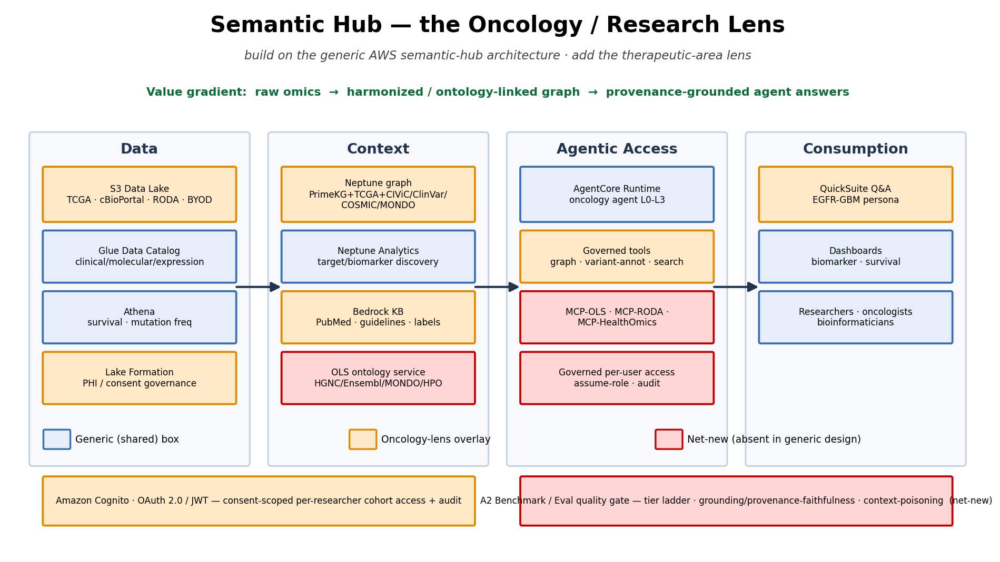

# Semantic Hub — the Oncology / Research Lens on the Reference Architecture

**Status: STRATEGIC (2026-08-13).** We do **not** reinvent the generic AWS semantic-hub + agent architecture —
we **build on it and add a therapeutic-area lens**. Generic semantic-layer accelerators already exist; our
differentiation is *what flows through each box* (curated oncology datasets + biomedical ontologies) plus a few
**net-new components** the generic design lacks. Companion to [accelerator-positioning.md](accelerator-positioning.md)
and [roda_oncology_hub_complete_reference.md](roda_oncology_hub_complete_reference.md). Figure:
`semantic-hub-oncology-lens.png` (regenerate via `figures/gen_oncology_lens.py`).

> **Value gradient (the "Data → Higher value" arrow, oncology framing):**
> **raw omics → harmonized / ontology-linked knowledge graph → provenance-grounded agent answers.**
> Value rises left-to-right as data is *harmonized to ontologies*, *linked in the graph*, and finally
> *grounded with provenance* in the agent's answer.

**Legend:** ✅ implemented in repo · ◻ partial / design / not wired · ➕ **net-new overlay** (not in the generic diagram — a differentiator).

---

## Layer-by-layer mapping

### Data lane — *bring specific oncology datasets to the forefront*
| Generic component | Oncology / research overlay | Status in our repo |
|---|---|---|
| S3 Data Lake (raw / curated-parquet) | TCGA/GDC (clinical + somatic mutations), cBioPortal (CNA + expression), **RODA open datasets**; **BYOD customer-cohort landing zone** | ✅ TCGA + cBioPortal in lake; RODA CIViC + Genoxus loaded; BYOD flow documented |
| AWS Glue Data Catalog | Oncology-domain DBs (`clinical` / `molecular` / `expression`) + genomics schema (VCF/MAF/Parquet) | ✅ `oncology_semantic_hub` + `oncology_semantic_hub_roda` Glue DBs |
| AWS Glue DataBrew (profile/stats/quality) | **Cohort QC** — variant-call quality, expression normalization, cohort/consent completeness | ◻ not wired (idea) |
| Amazon Athena | Oncology SQL — survival (median OS), mutation frequency, expression by subtype | ✅ `tcga_mutations`/`tcga_expression` + RODA tables; agent query tools |
| AWS Lake Formation | **PHI / consent governance** — per-study row-level access, patient-level masking | ◻ partial — governed per-user access is design (#21) |

### Context lane — *the graph + ontology differentiation*
| Generic component | Oncology / research overlay | Status in our repo |
|---|---|---|
| Amazon Neptune (property graph) | **Oncology knowledge graph** — PrimeKG backbone + TCGA cases, enriched by **CIViC / ClinVar / COSMIC / MONDO** | ✅ ~174K nodes / ~4M edges; `ta_oncology` CIViC extension |
| Neptune Analytics (algorithms / vector) | **Target & biomarker discovery** — centrality, community, PageRank, path-finding | ✅ `scripts/12_graph_algorithms.py` |
| Bedrock KB + RAG + vector store | **Oncology literature corpus** — PubMed, guidelines, drug labels, CIViC evidence | ✅ KB corpus via `agentcore/kb/build_corpus.py` (PubMed) + vector store |
| SageMaker Unified Studio | Bioinformatics / translational notebooks | ◻ not used (we use scripts + agent) |
| **➕ Ontology / Terminology service (OLS)** | HGNC / Ensembl / MONDO / HPO / NCIt harmonization — *"ontologies to the forefront"* | ✅ OLS integrated (ontology resolution) + MONDO enrichment (`15_add_mondo.py`) |

### Agentic Access lane — *research-specific tools*
| Generic component | Oncology / research overlay | Status in our repo |
|---|---|---|
| Bedrock AgentCore Runtime | Oncology research agent (tier L0–L3) | ✅ deployed (L0/L1/L2/L3 + ablations) |
| MCP-Athena / MCP-Graphs / MCP-Knowledgebase | Oncology tools: `query_knowledge_graph`, `query_variant_annotation`, `knowledge_search` | ✅ implemented as **custom governed boto3 tools** (per-user access) rather than shared-identity MCP |
| **➕ MCP-OLS / MCP-RODA / MCP-HealthOmics** | Ontology resolution · dataset discovery + BYOD onboarding · bioinformatics workflow execution | ◻ RODA MCP used for discovery (dev); OLS via tool; **HealthOmics not wired (#2)** |
| **➕ Governed per-user data tool** | `sts:AssumeRole` per identity → per-invocation session → CloudTrail/Neptune per-user audit | ◻ design (#21) |

### Consumption lane — *research personas*
| Generic component | Oncology / research overlay | Status in our repo |
|---|---|---|
| Amazon QuickSuite (BI + agent Q&A) | **Oncology researcher persona** (EGFR-GBM); biomarker / survival dashboards | ✅ 4-question EGFR-GBM demo; QuickSuite Q&A (Quick desktop) |
| User & Applications | Translational researchers, oncologists, bioinformaticians, clinical data scientists | ✅ persona framing |

### Auth (Amazon Cognito)
| Generic component | Oncology / research overlay | Status in our repo |
|---|---|---|
| Cognito user pool · OAuth 2.0 / JWT · federation | **Consent-scoped, per-researcher cohort access** + per-user audit trail | ◻ tied to governed per-user access (#21) |

### ➕ Cross-cutting overlay the generic design lacks — **A2 quality gate**
| Net-new component | Oncology / research overlay | Status in our repo |
|---|---|---|
| **Benchmark / evaluation quality gate (A2)** | Measures whether the graph+ontology layer *helps* — tier ladder, grounding / provenance-faithfulness, context-poisoning; roadmap → CI-gate | ✅ v2 benchmark, 84-Q, provenance-grounding; gating = future |

---

## The net-new oncology-lens overlays (the differentiators)
These boxes are **not** in the generic reference architecture; they are what the therapeutic-area lens adds:
1. **OLS ontology/terminology service** — biomedical ID harmonization as a first-class context component.
2. **Curated biomedical knowledge sources** feeding the graph — PrimeKG, CIViC, ClinVar, COSMIC, MONDO.
3. **RODA discovery + BYOD onboarding** — discover open oncology datasets and onboard customer cohorts.
4. **HealthOmics workflow lane** — VEP/annotation ETL for raw genomic (VCF/BAM) BYOD data *(not yet wired, #2)*.
5. **A2 benchmark/eval quality gate** — objective "is the semantic layer worth it, and what belongs in it."
6. **PHI / consent governance** across Lake Formation + Cognito + the governed per-user data tool.

---

## Diagram (Mermaid — renders in GitLab/GitHub)

```mermaid
flowchart LR
  subgraph DATA["Data — raw omics"]
    S3["S3 Data Lake<br/>TCGA/GDC · cBioPortal · RODA · BYOD cohort"]
    GC["Glue Data Catalog<br/>clinical / molecular / expression"]
    ATH["Athena<br/>survival · mutation freq · expression"]
    LF["Lake Formation<br/>PHI / consent governance"]
  end
  subgraph CTX["Context — harmonized / ontology-linked"]
    NEP["Neptune graph<br/>PrimeKG + TCGA + CIViC/ClinVar/COSMIC/MONDO"]
    NA["Neptune Analytics<br/>target/biomarker discovery"]
    KB["Bedrock KB<br/>PubMed / guidelines / labels"]
    OLS["OLS ontology service<br/>HGNC/Ensembl/MONDO/HPO/NCIt"]
  end
  subgraph ACC["Agentic Access"]
    RT["AgentCore Runtime<br/>oncology agent L0-L3"]
    TOOLS["Governed tools<br/>graph · variant-annotation · knowledge_search"]
    OV["MCP-OLS · MCP-RODA · MCP-HealthOmics"]
  end
  subgraph CONS["Consumption — provenance-grounded answers"]
    QS["QuickSuite Q&A<br/>EGFR-GBM researcher persona"]
    USERS["Researchers · oncologists · bioinformaticians"]
  end
  COG["Cognito · OAuth/JWT<br/>consent-scoped per-researcher access"]
  A2["A2 Benchmark / Eval quality gate<br/>tier ladder · grounding · context-poisoning"]

  DATA --> CTX --> ACC --> CONS
  COG -.authenticates.-> ACC
  A2 -.measures.-> ACC

  classDef overlay fill:#ffe9c7,stroke:#e08a00,stroke-width:2px;
  classDef netnew fill:#ffd6d6,stroke:#c40000,stroke-width:2px;
  class OLS,OV,A2 netnew;
  class S3,NEP,KB,LF,TOOLS,QS overlay;
```

*Orange = generic boxes carrying oncology data/tooling; red = net-new overlays absent from the generic design.*

## Rendered figure

