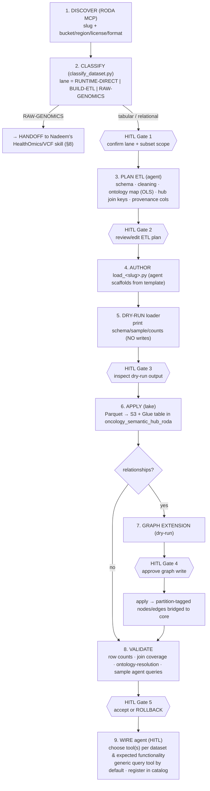

# Skill Design — Agent-Driven RODA → Semantic Hub Onboarding (backlog #17)

**Status: DESIGN (2026-08-13).** Shapes backlog **#17** (HITL data-discovery + ETL-authoring skill) into a
concrete capability. Consolidates the intent of **#11** (multi-step workflow skills) and the onboarding half of
**Category B**. Companion to [roda_oncology_hub_complete_reference.md](roda_oncology_hub_complete_reference.md)
(dataset catalog + lanes), [roda_executive_summary.md](roda_executive_summary.md) (readiness horizons),
[backlog.md](backlog.md), and [accelerator-positioning.md](accelerator-positioning.md).

> **Scope note / no duplication:** **Nadeem owns the raw-genomic (VCF/BAM) → HealthOmics processing skill**
> (1000 Genomes and similar; backlog **#2 / #19**). This skill **does not build** that lane — it *detects* it and
> **hands off** via a defined contract (§8). Our focus is the **generic, agent-driven onboarding of tabular /
> relational RODA datasets** into the hub, with human-in-the-loop and custom ETL authoring.

---

## 1. Purpose
Let an **agent + a human** collaboratively onboard *any* tabular/relational RODA dataset into the oncology
semantic hub — **discover → classify → plan ETL → (approve) → author + run custom ETL → land in lake (+ optional
graph extension) → wire the agent (HITL) → [validate]** — with provenance, ontology harmonization, and rollback at
every step. This is the concrete **"beyond-TCGA" BYOD proof point**: value = the *method*, demonstrated on
oncology. The **core is the agent-driven (conversational) onboarding flow** — the same human+agent collaboration
we do now, in the backend. A **guided UI is an optional visibility layer (a "cherry on top", P2)** that makes the
flow a visible experience; it is *not* required for the capability to work.

> **Generic-wrapper principle (do not violate).** The onboarding wrapper is **dataset-agnostic**. It hardcodes
> **no** dataset-specific query tools (e.g. *not* a fixed `query_variant_annotation`). It discovers the dataset,
> helps process it (custom ETL), and **wires the agent with a HITL decision**: the human + agent decide, per
> dataset and expected functionality, *which* tool(s) expose it — a **generic query tool** (parameterized
> Athena SQL / graph Cypher over the new table/partition) by default, or a purpose-specific tool co-designed with
> the human only when the functionality requires it. Dataset-specific tools are an *output* of the wiring step,
> never an *assumption* baked into the wrapper.

> **Build order (owner guidance 2026-08-14).** Get the **generic agent-driven add + custom-ETL run** working
> *first*; the **validation harness is the next step**, not a prerequisite. Until it exists, the **human's dry-run
> review at the HITL gate is the interim validation.** (See §12.)

> **Execution model — Q1 decision (2026-08-14).** Custom ETL runs in a **native AgentCore Code Interpreter**
> sandbox, driven by the onboarding **orchestrator agent** — chosen for **fast deploy/test + minimal infra**
> (no VPC/NAT/S3 Files/ECR/container). HITL is clean: orchestrator proposes code → human approves → `execute_code`.
> The heavier coding-agent runtime (`01-claude-code-with-s3-files`) is **deferred to P2 (optional)** — only if an
> autonomous coding-agent-as-a-service becomes a product need. HealthOmics is triggered via **MCP (`omics:StartRun`)**,
> not code execution. **P0 plumbing check (one item in the hardened P0, §12):** a Code Interpreter session runs Athena `SELECT 1` + `omics:ListRuns`
> under the execution role — proves "trigger any service incl. HealthOmics." *(Plumbing only; §12 items 1–4 de-risk the architecture bets.)*
> **Concrete primitive (verified against `03-connect-your-agent-to-anything/01-code-interpreter`):** a Strands
> orchestrator with an `execute_python` tool over `code_session()`; a **custom interpreter resource**
> (`executionRoleArn` + `networkMode: PUBLIC`) gives the sandbox scoped AWS perms + egress; `04-run-commands`
> demonstrates in-sandbox `pip install` + `aws` CLI. Reuse `utils/code_interpreter_agent.py` as the starting shape.

> **Semantic-hub alignment — Q2 decision (2026-08-14).** **Agent-guided, suggestion-first**, anchored on the
> **two core alignment principles of the semantic hub: (1) extend the graph core** (new nodes/edges bridged to core
> `gene_protein`/`drug`/`disease`, `ta_oncology` partition, **core never mutated**) and **(2) connect to the patient
> data lake** (join to clinical/molecular Athena tables via shared keys — Hugo, `chr:pos:ref:alt`, `case_id`, MONDO),
> with **OLS ontology harmonization** as the connective tissue. The orchestrator introspects the **live hub**
> (`get_graph_schema` + Glue/Athena catalog + OLS) + the RODA dataset, **suggests** how the dataset does both, with
> rationale; the **human approves/edits** (HITL). Mappings are **live-inferred per dataset**, not pre-declared. A
> **thin guardrail profile** holds only invariants (core immutable · edges tagged `ta_oncology` · provenance
> required · onboarded data = L3-only). Delivered via a **separate onboarding UI page** (agent-guided chat), distinct
> from the L3 query UI. This is the orchestrator's job — **not** L3 (L3 is the read-only consumer of the result).

> **Tool wiring — Q3 decision (2026-08-14).** **The semantics *are* the semantic hub** (graph + ontology +
> Glue/Athena catalog) — not a separate artifact. Wiring = **generic execution over hub semantics**: onboarding
> registers the new lake table in the **Glue/Athena catalog** and extends the **graph** (ontology-harmonized,
> `ta_oncology` partition); the L3 agent's **existing generic tools** (`query_knowledge_graph` + Athena SQL) plus
> **catalog/schema introspection** (`get_graph_schema`, Glue `get_tables`) discover and reach it — **no per-dataset
> tool**. **⚠ "No redeploy" is a P0 hypothesis, not a proven fact** — it depends on dynamic catalog discovery that
> §7 lists as **not yet built** ("tables near-static in the prompt"). P0 must prove L3 discovers a freshly-registered
> table + graph labels **without redeploy**; if it can't, "no redeploy" becomes a **P1 deliverable** (fallback:
> prompt-refresh/redeploy). **For now the Glue/Athena catalog suffices** (no bespoke registry). **AgentCore Registry +
> Gateway semantic discovery = P2** — add when we need governed runtime discovery, genuinely-new *capability* tools,
> and the Quick+Gateway experience. Core extensions that **map to existing constructs** are reached by generic
> traversal; a genuinely **new capability** gets a registered tool (P2). **Value prop: generic execution + hub
> semantics → the semantic hub can take you to any data.**

> **Hybrid refinement — post independent review (2026-08-14).** The static `scripts/roda/` scripts remain the
> **backbone**; the agent is a **guided front-end**, not an autonomous author-and-execute engine. The orchestrator
> discovers, classifies (calls `classify_dataset.py`), **suggests** alignment, and **parameterizes vetted,
> generalized templates** (`load_*` / `graph_extension`) that run dry-run→approve→apply with the scripts' existing
> guarantees (idempotency, rollback, provenance, `ta_oncology`-only bridging). **Free-form sandbox authoring is a
> gated escape hatch**, used only when a dataset genuinely can't be handled by a parameterized template. This
> **collapses B5** (the template enforces core-immutable bridging *by construction*) and **shrinks B1** (vetted
> code, not arbitrary code over untrusted metadata). Full autonomous-agentic authoring is **not** adopted for the
> CIViC/UK-Biobank demos.

**Why this goes beyond the RODA MCP server.** RODA MCP is **discovery-only** (`search_datasets`,
`get_dataset_details`, `preview_dataset`, `sample_dataset`). It tells you *what exists*. It does **not**: decide an
onboarding lane, author a custom ETL, harmonize terms to ontologies, bridge join keys to the hub graph/lake, write
provenance, wire the agent, or roll back. This skill orchestrates all of that on top of RODA MCP.

### 1.1 Canonical onboarding stages (generic wrapper + guided UI)
The wrapper is a **generic, dataset-agnostic** capability delivered as an **easy, guided onboarding experience in
the UI** — one step per stage, each with a HITL approve / edit / abort, progress, and rollback:

| # | Generic stage (owner articulation) | What happens | AWS surface | HITL |
|---|---|---|---|---|
| 1 | **Discover & select a dataset** | Browse/search RODA and pick one; pull metadata + preview | **RODA MCP** (`search/get_details/preview/sample`) | select |
| 2 | **Align with the semantic-hub constructs** | Decide the **graph-extension** shape (nodes/edges bridged to core) + **ontology** mapping (source terms → MONDO/HGNC/Ensembl/NCIt) | **OLS** · Neptune schema | review/edit mapping |
| 3 | **ETL planning** | Draft the custom transform to produce hub-aligned table(s)/edge(s): schema, cleaning, join keys, provenance | (plan only) | review/edit plan |
| 4 | **Execution & storage** | Run the custom ETL; **store in the appropriate database** — Athena lake table in `oncology_semantic_hub_roda` and/or Neptune graph partition | **Glue/Athena/S3** · **Neptune** | dry-run → approve → apply |
| 5 | **Agent tool wiring** | Wire the tool(s) that **retrieve the data via the appropriate AWS service API** (Athena SQL for lake, Neptune Cypher for graph, …) — **generic query tool by default**, purpose-specific only if the expected functionality requires it | AgentCore / tool config | choose + confirm tool(s) |

**Primary surface = agent-driven (chat) flow:** the human + agent walk stages 1→5 conversationally, with an
approval at each — no CLI or UI required (this is exactly how we're reasoning through it now). **The guided UI is
a cherry on top** — an optional visibility layer (P2, §12) that turns the backend agentic flow into a visible,
demo-friendly experience. It is not needed for the capability to work.

*Reconciliation with §4:* stages 1–2 = discover + classify + align; stage 3 = plan; stage 4 = author + dry-run +
apply (+ optional graph extension); stage 5 = wire agent. Validation (§6.1 harness) attaches to stage 4/5 as the
P1 follow-on (§12) — until then the stage-4 dry-run approval is the interim check.

## 2. In scope / out of scope
**In scope**
- Tabular/relational RODA datasets → **Athena lake table** (BUILD-ETL) and/or **Neptune graph extension** (relationships).
- **RUNTIME-DIRECT** zero-copy option (Athena external table over RODA's bucket) when appropriate.
- Agent-driven **ETL authoring** (scaffold a new `load_<slug>.py` from the classifier's schema output).
- **HITL gates** with graduated automation (Nadeem's trust model, #19).
- **Semantic-hub alignment**: ontology harmonization (OLS), join-key bridging, provenance, agent registration, rollback.

**Out of scope (delegated / deferred)**
- **Raw genomic VCF/BAM → HealthOmics → S3 Tables** → **Nadeem (#2/#19)**. We route to it (§8); we do not build it.
- ML/imaging specialized lanes (CAMELYON, CHIMERA, CELLxGENE) — future (#14).

**Alignment with the RODA readiness horizons** (`roda_executive_summary.md`): the skill targets the
**🟢 Immediate** tier (6 datasets — CIViC, Genoxus, SnpEff, Beat AML, CPTAC-3, CCLE: tabular → Parquet → Athena/Neptune)
and the **Athena/Neptune-ETL subset of 🟡 Short-term** (ENCODE, UK Biobank GWAS, HCMI, MMRF, Cell Painting). The
**🔴 Longer-term HealthOmics/VEP** tier (1000 Genomes, ICGC, Kids First, Exceptional Responders, MP2PRT, mCRPC,
LUAD, CGCI) is **Nadeem's lane** (§8 handoff). The SDK-heavy 🟡 items (CELLxGENE TileDB-SOMA, ESM/DPEB embeddings)
and 🔴 imaging (CAMELYON/CHIMERA) are specialized and deferred to **#14**.

## 3. Primitives we reuse (already in the repo — `scripts/roda/`)
| Primitive | Role in the skill | State |
|---|---|---|
| RODA MCP (`search/get_details/preview/sample`) | **Discover** candidate datasets + metadata | ✅ available |
| `classify_dataset.py` | **Classify** the onboarding lane (RUNTIME-DIRECT vs BUILD-ETL vs RAW-GENOMICS) from metadata + live S3 preview | ✅ exists |
| `load_civic.py` / `load_genoxus.py` | **Template** for a parameterized loader (public read → clean → Parquet → Glue register; `--dry-run` default, `--apply`-gated) | ✅ exist (per-dataset) |
| `graph_extension.py` | **Relationship** lane — partition-tagged (`ta_oncology`) nodes/edges bridged to PrimeKG core; **core never mutated**; `--drop` rollback | ✅ exists (CIViC-specific) |
| **Generic query tool** (parameterized Athena SQL / `query_knowledge_graph` Cypher over any table/partition) | **Query** onboarded data with `[RODA:<table>]` provenance — default access path | ✅ generic path exists |
| Dataset-specific tools (e.g. `query_variant_annotation`) | **Examples** of purpose-built tools — *wired per dataset via HITL, never assumed by the wrapper* | ✅ exist as examples |

## 4. The onboarding flow (phases + HITL gates)

## 5. HITL / graduated-automation model (with Nadeem, #19)
Each gate supports **approve / edit / abort**. Automation graduates by policy, not all-or-nothing:
- **Always HITL** (never auto): graph writes, anything touching PHI/consent, first-time onboarding of a new dataset.
- **Auto-approvable by config**: RUNTIME-DIRECT external table for a **same-region, CC0/open, well-formed tabular** dataset; re-runs of a previously-approved loader (idempotent).
- Policy lives in a small config (e.g., `roda_onboarding.policy.json`): per-lane / per-license / per-region auto-approve rules. Mirrors the "step-by-step → config-driven autonomy" progression.

## 6. Semantic-hub alignment principles (non-negotiable, inherited from `scripts/roda/`)
1. **Additive only** — new `oncology_semantic_hub_roda` Glue DB + `partition='ta_oncology'` graph partition; **core never mutated**.
2. **Provenance on everything** — `source_snapshot` + `license` on every row/node; agent tags `[RODA:<table>]`.
3. **Ontology-anchored (the therapeutic-area lens)** — harmonize source disease/gene/variant terms to **MONDO / HGNC / Ensembl / NCIt via OLS** during planning; store both raw + resolved IDs.
4. **Join-key bridging** — map to existing hub keys: Hugo Symbol → `gene_protein.name`; `chr:pos:ref:alt` → `tcga_mutations`; MONDO → `disease`; DrugBank → `drug`.
5. **Rollback-able** — `graph_extension --drop` + drop Glue table + S3 prefix (verified pattern).

### 6.1 The L3 consumption contract (how alignment is *enforced*)
"Aligned with L3" means the onboarded dataset produces exactly the artifacts the **L3 agent already consumes** —
CIViC is the proven reference; the skill generalizes it. Every onboarding must satisfy:

| # | Contract clause | L3 mechanism it feeds |
|---|---|---|
| 1 | **Lake table** in `oncology_semantic_hub_roda` with declared **join keys** (Hugo→`gene_protein.name`, `chr:pos:ref:alt`→`tcga_mutations`, MONDO→`disease`) | **generic** Athena SQL tool over the new table + cross-joins to `oncology_semantic_hub.tcga_*` |
| 2 | **Graph edges** (if relational) in a **droppable partition**, bridged to core `gene_protein`/`drug`/`disease` by shared IDs; **core never mutated** | **generic** `query_knowledge_graph` (Cypher) traversal |
| 3 | **Ontology-resolved IDs** (OLS: MONDO/HGNC/Ensembl/NCIt), raw + resolved stored | consistent joins + the therapeutic-area lens |
| 4 | **Provenance columns** (`source_snapshot`, `license`) on every row/node | agent `[RODA:<table>]` tagging + A2 grounding |
| 5 | **Tier boundary** — data is **L3-only**; must not leak to L0/L1/L2 | preserves the benchmark's measured L2→L3 lift |
| 6 | **Agent wiring (HITL)** — human + agent choose which tool(s) expose the dataset (generic query tool by default; dataset-specific tool only if functionality requires); dataset registered in a catalog | *(build: generic wiring step + dynamic catalog — no hardcoded per-dataset tools)* |
| 7 | **A2 help-or-poison check** — before/after L3 query + grounding/correctness spot-check | the "what belongs in the layer" gate (ties to #18) |

**The validation harness IS the alignment test:** join-coverage %, ontology-resolution %, and a before/after L3
answer. Pass → the dataset is L3-aligned by definition. Clauses 1–5 are already demonstrated by CIViC; the only
genuinely new alignment mechanism to build is **#6 — the generic agent-wiring step (HITL tool choice + a
dynamic catalog), with no hardcoded per-dataset tools**.

## 7. What exists vs what we build vs what's delegated
| Capability | Status | Owner |
|---|---|---|
| Discovery (RODA MCP) | ✅ exists | — |
| Lane classification (`classify_dataset.py`) | ✅ exists | — |
| Loader template + dry-run/apply gating | ✅ exists (per-dataset) | — |
| Graph extension (partition/rollback) | ✅ exists (CIViC-specific) | — |
| **Orchestration skill (SKILL.md + agent glue + HITL gates)** | ◻ **build** | us (#17) |
| **ETL authoring / codegen** — scaffold `load_<slug>.py` from classifier schema | ◻ **build** | us (#17) |
| **Generalize `graph_extension.py`** — CIViC-hardcoded → mapping-spec-driven (node/edge/bridge spec) | ◻ **build** | us (#17) |
| **Ontology-harmonization step** wired into planning (OLS lookups) | ◻ **build** (OLS tool exists) | us (#17) |
| **Validation harness** — join-coverage + ontology-resolution + sample-query checks | ◻ **build** | us (#17) |
| **Dynamic agent registration** of newly onboarded tables | ◻ **build** (today the RODA tables are near-static in the prompt) | us (#17) |
| **Raw-genomic VCF/BAM → HealthOmics → S3 Tables** lane | ◻ delegated | **Nadeem (#2/#19)** |

## 8. Interfaces / contracts
- **Classifier output** (`classify_dataset.py`): `{slug, bucket, region, license, format, partitioning, size_estimate, lane ∈ {RUNTIME_DIRECT, BUILD_ETL, RAW_GENOMICS}, rationale}`.
- **ETL plan spec** (agent-produced, human-editable): `{source_keys, cleaning_steps, target_db, target_table, target_schema, ontology_map:[{source_field, ontology, resolved_id_field}], hub_join_keys, provenance_cols}`.
- **Graph mapping spec** (for the generalized extension): `{node_label, node_props, edge_type, bridge:{match_core_label, on_key}, partition}`.
- **Handoff-to-Nadeem contract (RAW_GENOMICS):** emit `{slug, bucket, region, file_type ∈ {VCF,BAM,CRAM}, ref_build, target: "healthomics_vep"}` to Nadeem's skill; on completion it returns an Athena table name we then treat like any BUILD-ETL output for §8-9 (validate + register). **No processing logic duplicated here.**

## 9. Demo plan — generic wrapper first, then CIViC → UK Biobank as sample datasets
**Sequence (owner, 2026-08-14):** build the **generic wrapper (P0)** first, then use **CIViC** as sample dataset
**#1** and **UK Biobank** as sample dataset **#2** — both onboarded *through the generic wrapper*, **not** the
existing hardcoded path.

**Sample #1 — CIViC, via the generic wrapper (the reliable proof + genericity check).**
CIViC is **us-west-2 CC0**, and we already have a **known-good result** (the existing `civic_evidence` table +
`ta_oncology` edges) to diff against.

> **⚠ CIViC is ALREADY in L3 (decided 2026-08-14).** L3 already has `civic_evidence`, the `ta_oncology` CIViC
> extension, and a generic `query_variant_annotation(sql)` (arbitrary SQL over the `oncology_semantic_hub_roda` DB).
> **The onboarding feature is fully self-contained** (all code in `dataset_onboarding/`); its **only footprint on
> the rest of the hub is the data it writes + semantic additions** — *no code coupling to L3.* So:
> - **Objective = dynamic RODA-MCP-driven, agent-guided load in the UI** (not manual scripts). Discovery uses the
>   **RODA MCP server**; the agent parameterizes the vetted `load_civic` template.
> - **Minimal staging (no heavy machinery):** land in an **additive** `oncology_semantic_hub_roda.civic_evidence_staging`
>   table (prod `civic_evidence` untouched) — kept only so the demo is *verifiable* (the table exists solely because
>   the agent just created it). One-flag switch to refresh prod instead if desired.
> - **Graph = extension only (user directive):** append **only** to the `ta_oncology_staging` partition, bridged to
>   core by `MATCH`; **core `gene_protein`/`drug`/`disease` are NEVER mutated** (B5 guardrail).
> - **Correctness gate:** diff staging vs known-good prod `civic_evidence`/`ta_oncology`.
> - **L3 query proof — NO L3 change:** L3 reaches `civic_evidence_staging` via its **existing** generic
>   `query_variant_annotation(sql)` — no code change, no redeploy (the Q3 "no per-dataset tool" proof). Running it *through the generic path* (generic transform → generic query
tool → catalog, **not** `load_civic.py`/`query_variant_annotation`) is therefore both **low-risk** *and* **proves
genericity**. Payoff: the crisp L3-only answer *"What drugs have clinical evidence for EGFR L858R?"* — and we
validate by diffing the generic-path output against the known-good hardcoded output.

**Sample #2 — UK Biobank Pan-GWAS (proves it generalizes to an unseen dataset).**
Summary stats → `gwas_cancer_associations`; join gene → `gene_protein` (germline-risk answer). us-east-1
(one-time copy). A dataset the wrapper has **never seen** — the real generality test.

Both avoid the VCF lane (Nadeem, §8). SnpEff / CCLE remain optional later examples. **The wrapper is the
deliverable; CIViC and UK Biobank are how we exercise and prove it.**

## 10. Risks / open questions
- **ETL codegen quality** — generated loaders must match the repo's safety contract (UNSIGNED read, dry-run default, provenance). Mitigation: constrain generation to the proven template; human reviews at Gate 2/3.
- **Ontology-resolution coverage** — some source vocabularies won't map cleanly to MONDO/HGNC; surface unresolved terms at Gate 2 rather than silently dropping.
- **Agent registration mechanism** — decide dynamic (agent reads a live table catalog) vs redeploy; affects how "instant" onboarding feels.
- **Policy boundaries** — finalize the auto-approve matrix with Nadeem (#19) so graduated automation is safe by default.
- **Where the skill runs** — Kiro Power / AgentCore skill packaging (aligns with the HealthOmics Kiro Power referenced in the RODA doc).

## 11. Backlog linkage
- **#17** ← this design (primary).
- **#11** — the multi-step orchestration is realized here; consider merging.
- **#2 / #19 (VCF/HealthOmics)** — **delegated to Nadeem**; this skill defines only the handoff (§8).
- **#20 (Indradeep)** — the additive/provenance/rollback principles (§6) should conform to his semantic-layer patterns.

## 12. Build sequence (priority — owner guidance 2026-08-14)
Reordered from an earlier "validation-first" draft: **functionality first, validation next.** The HITL human
review is the interim safety gate until the harness exists.

- **P0 — Fail-fast: kill the riskiest assumptions cheaply, *before* P1 (hardened after independent review,
  2026-08-14).** The earlier "SELECT 1 + `omics:ListRuns`" spike only proved *plumbing*, not the architecture bets.
  Ordered checklist — each item = the assumption it kills + a cheap test:
  1. **No-redeploy L3 discovery** — register a dummy table in `oncology_semantic_hub_roda` + a dummy `ta_oncology`
     node; confirm L3 discovers + queries it with **no redeploy**. *(Kills the Q3 "no redeploy" claim — see §7. If it
     fails, "no redeploy" is reclassified to P1; fallback = prompt-refresh/redeploy.)*
  2. **Security go/no-go** — `networkMode: PUBLIC` (all-or-nothing egress) + a write-scoped role + agent-authored
     code over *untrusted RODA metadata* = an exfiltration path; plus `iam:PassRole` (HealthOmics) held by the
     code-running role = priv-esc. Decide the posture (VPC+endpoints / egress proxy / accept-with-controls)
     **before** running agent-authored code. **Hard blocker (B1).**
  3. **Templated path vs free-form** — run CIViC via the **parameterized template path** (generalized
     `load_*`/`graph_extension`, Athena CTAS), **not** free-form authoring; diff vs known-good. Only reach for the
     free-form Code Interpreter sandbox if a dataset (e.g. UK Biobank) truly can't be templated. *(Kills "do we even
     need free-form authoring / the sandbox?")*
  4. **Core-immutability probe** — attempt a core `MERGE` under the orchestrator role; confirm the guardrail holds.
     IAM can't distinguish core vs `ta_oncology` on a per-graph write, so the enforcement mechanism is the
     **template/write-path** (emits only `ta_oncology`, `MATCH`-bridged to core) **+ a post-write core-count diff** —
     the hybrid collapses this to by-construction; P0 **verifies** it. **(B5 — largely collapsed; probe confirms.)**
  5. **Ontology-mapping accuracy** — agent-proposed MONDO/HGNC mappings vs a hand-verified key; measure the rate of
     plausible-but-wrong mappings that would survive HITL.
  6. **Validation identity / PHI** — §6.1 join-coverage validation needs reads of patient tables (`tcga_mutations`,
     `case_id`) that `iam/` forbids for the orchestrator; define the validator's identity. **(B4)**
  7. **CIViC diff = correctness gate** — generic-path output diffed vs the known-good `civic_evidence`/`ta_oncology`.
     *(Proves re-derivation; note CIViC is hub-informed — the real generality test is #8.)*
  8. **UK Biobank size/cost probe** — an unseen, larger dataset: measure Code Interpreter session limits + Athena
     scan cost; sets scale/cost guardrails.
  **Proceed to P1 only if 1–4 pass.** Human dry-run approval = interim validation until the P1 harness exists.
- **P1 — Validation harness (the "good next step").**
  Join-coverage %, ontology-resolution %, before/after L3 answer + A2 help-or-poison spot-check. Converts the
  human gate into a repeatable, automatable check.
  - **P1.0 — Second-dataset generality gate (do FIRST in P1, before hardening).** The moment CIViC works
    end-to-end, prove we didn't build for one data type: (a) run the *same* orchestrator against **Genoxus**
    (existing `load_genoxus` template — deliberately different shape: nested→flat, variant-coord join, **lake-only,
    no graph edges**) — must work with **no orchestrator code change**; then (b) an **unseen** dataset (SnpEff or
    1000G allele-freq — variant-coord, lake-only, no prior template) to test classify→parameterize on something new.
    If Genoxus needs orchestrator changes → we over-fit to CIViC; fix before hardening.
- **P2 — Hardening & scale.**
  Graduated-automation policy (#19), generalized graph-extension mapping-spec, dynamic catalog registration,
  broader ETL codegen scope, and the **optional guided UI (visibility layer — the "cherry on top")**. "Onboard
  *any* dataset" is the destination here, not the first milestone.

**Genericity is a P0 constraint, not a P2 nicety:** the wrapper must be generic from the start (no
`query_variant_annotation`-style assumptions) — tool wiring is always a per-dataset HITL decision.
